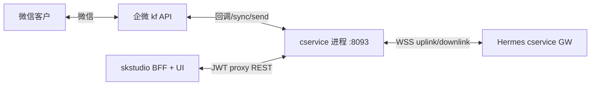
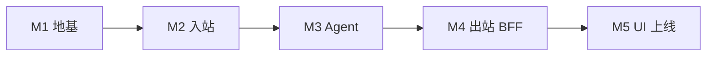
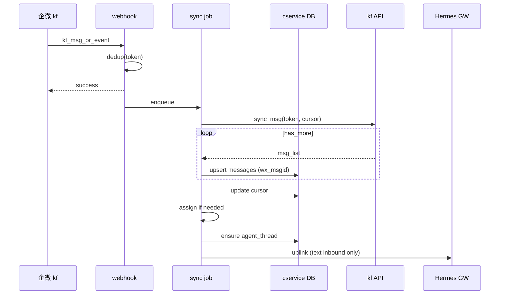
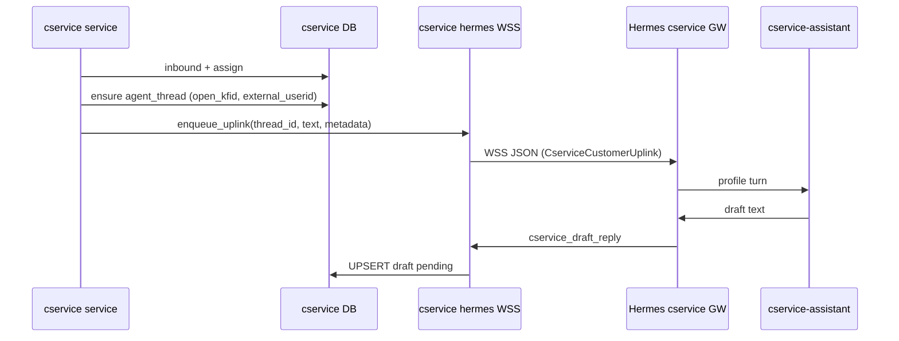

# cservice · 客户服务 产品设计

- **文档类型**：~~产品共识 + 架构与 MVP 验收真源~~ → **历史存档**
- **版本**：**v0.9.24**
- **状态**：**废止为运行真源**（2026-07-31 · 待 **P0** 拆除 · 含 UI）· 规范见 [平台控制面与Postgres迁移共识.md](../../platform_docs/平台控制面与Postgres迁移共识.md) **D1/D19** · 勾选见 [TODO.md P0](../../platform_docs/TODO.md)
- **产品定位（历史）**：**独立 repo `cservice`**（域 + API + 企微 kf）+ skstudio **UI 壳 + BFF** — 微信客户 ↔ 企微 API ↔ 接待人员 + **客服助手** Hermes Agent
- **壳层入口（历史）**：skstudio 底 Tab **「客服」** · 路由 **`/cservice/*`** · **将删除**

**关联文档**

| 文档 | 用途 |
| ---- | ---- |
| [TODO.md](../../platform_docs/TODO.md) | 实现勾选 · 剩余开放项 |
| [组织知识库.md](../../knowledge_base/docs/组织知识库.md) | **架构同构参照**：`knowledge_base` 独立 repo + skstudio UI 壳 |
| [目标与执行及其组织支撑(实现与测试).md](./目标与执行及其组织支撑(实现与测试).md) | **架构同构参照**：`goal_execution` 双仓 · BFF · service token · **§2.4 GE 对照** |
| [目标与执行及其组织支撑(需求).md](./目标与执行及其组织支撑(需求).md) | **Person ≡ User** · 评审员 · org 边界（§2.3 · §2.5） |
| [skstudio-组织与企微同步.md](../../skstudio/docs/skstudio-组织与企微同步.md) | 人员主数据 · org BFF · 设置 UI 人员选择器复用 |
| [开发和部署.md](../../platform_docs/开发和部署.md) | §2.4 kbase · §2.5 ge 三联调/四联调；**cservice 见本文 §2.3** |
| [Personal-Assistant产品设计.md](../../platform_docs/hermes-self/Personal-Assistant产品设计.md) | Hermes 独立 profile + `gateway_role` 隔离 |
| [Hermes与组织知识库的集成.md](../../platform_docs/integration/hermes-knowledge_base/Hermes与组织知识库的集成.md) | service token / sender 头约定（若 Agent 读 kbase · P2） |
| [微信客服 · 企微官方](https://developer.work.weixin.qq.com/document/path/94638) | kf API · 回调 · sync_msg / send_msg |
| [hermes-profiles/cservice-assistant/](../../platform_docs/agent-schema/README.md) | **客服助手** profile 模板（§25） |
| [hermes-profiles/cservice-group-assistant/](../../platform_docs/agent-schema/README.md) | **企微群助手** profile 模板（§25 旁链 · 二期） |
| [cservice-产品设计-二期.md](./cservice-产品设计-二期.md) | **二期**：企微客户群 · 多对1 · Bot agent-inside（**P4** · 与 M8 运营分开） |

**代码仓库（normative · v0.9.0）**

| Repo | 内容 | 不包含 |
| ---- | ---- | ------ |
| **`cservice`**（**独立 repo**） | 独立进程（默认 **`:8093`**）、REST API、SQLite、Alembic、`kf` webhook/sync/send/分配、Hermes WSS 适配（`gateway_role=cservice`）、`cservice-assistant` 起草闭环 | skstudio UI、员工 OAuth |
| **`skstudio`** | `frontend/src/cservice/` UI 壳 · 薄 BFF `/api/v1/cservice/*`（JWT → service token 转发）· Tab「客服」 | cservice 域表、企微 kf 客户端、sync 流水线、**禁止** skstudio 侧 `cservice_*` migration |
| **`hermes-agent`** | `cservice-assistant`（kf WSS + **群 aibot ingress**）· **`cservice-group-assistant`** profile 运行时 | cservice 域逻辑；Gateway WSS 连 **`cservice` 进程**（非 skstudio master WSS） |

**实现仓库**：[cservice](https://github.com/pumpkinale999/cservice)（M1 脚手架 · `:8093`）

---

## 文档地图

| 部分 | 章节 | 读谁 |
| ---- | ---- | ---- |
| 范围与一句话 | §0 | 全员 |
| **MVP closure vs post-M5 增量** | **§0.4–§0.7** | **PM、研发** |
| **M6 实现速查** | **§0.7** | **研发、QA** |
| 产品目标与非目标 | §1 | 产品、研发 |
| 架构决策（已冻结） | §2 | 架构、研发 |
| **GE 同构 · One Reality** | **§2.4–§2.5** | **架构、后端** |
| **代码仓库 · 双仓分工** | **§2.2–§2.3** | **架构、后端** |
| 与其他模块边界 | §3 | 全员 |
| 企微 / 微信客服 | §4 | 运维、后端 |
| Hermes · **客服助手** Agent | §5 | 研发、运维 |
| **客户 / Thread 身份** | **§13.5** | 后端、架构 |
| skstudio · 客户服务 UI | §6 · **§6.1.1 访问门禁** · **§6.7 接待设置** | 产品、前端 |
| 数据流 | §7 | 后端、架构 |
| MVP 默认行为 | §8 | 产品、研发 |
| **会话生命周期** | **§8.2** | **后端** |
| 开放项 | §9 | PM、架构 |
| 阶段与验收 | §10–§11 | 研发、QA |
| **MVP 验收 CS-01–18** | **§11.1** | **QA** |
| **M6 验收 CS-19–25** | **§11.2** | **QA、运维** |
| **M7 验收 CS-26–28** | **§11.3** | **QA** |
| **修订记录** | **§12** | 全员 |
| **MVP 实现 Milestones** | **§10.1** | **研发、PM** |
| **post-M5 增量（M6 规格）** | **§10.3** | **研发、PM** |
| **M7 · 接待配置与 Tab 门禁** | **§10.4 · §6.7 · §14.1** | **研发、PM** |
| **二期 · 企微客户群（P4）** | **[cservice-产品设计-二期.md](./cservice-产品设计-二期.md)** | **产品、架构** |
| **Milestone 总览 · 追踪** | **§10.2** | **研发、PM** |
| **领域模型** | **§13** | **后端** |
| **BFF API 纲要** | **§14** | **前后端** |
| **Hermes 集成契约** | **§15** | **后端、运维** |
| **运维与环境变量** | **§16** | **运维** |
| **企微 kf API 附录** | **§17** | **后端** |
| **双仓改造清单** | **§18 · §18.5 M6 · §18.6 M7** | **后端、运维** |
| **MVP 消息与降级** | **§19** | **产品、前后端** |
| **Webhook 验签解密 SOP** | **§20** | **后端、运维** |
| **入站流水线与幂等** | **§21** | **后端** |
| **Hermes 端到端时序 · WSS 协议** | **§22 · §22.3–§22.5** | **后端** |
| **出站送达与失败** | **§23** | **后端、前端** |
| **前端组件树** | **§24** | **前端** |
| **Hermes profile 模板** | **§25** | **运维、后端** |
| **企微 token / HTTP 客户端** | **§26** | **后端** |
| **测试 fixture 与联调** | **§27** | **后端、QA** |
| **DB Migration 纲要** | **§28** | **后端** |
| **Profile install 脚本规格** | **§29** | **运维、后端** |
| **生产部署清单** | **§30** | **运维** |
| **M6 生产 smoke** | **§30.4** | **运维、QA** |

---

## 0. 范围

### 0.1 一句话

**在 skstudio「客服」Tab 与独立服务 `cservice` 协同：微信客户通过客服链接 1:1 进线；`cservice` 以企微 API 自管拉消息/分配/代发；**客服助手** Hermes 起草建议；接待人员在 UI **公共池** 查看全部进线，在 **助手回复区** [发送]/[编辑] 或 **人工回复区** 定稿后发送（UI **只调 `cservice` REST**，经 BFF 转发 JWT）。**

### 0.2 MVP「可工作」定义（closure 口径）

同时满足：

| 类 | 含义 | 验收锚点 |
| --- | --- | --- |
| **管道** | kf 回调 + `sync_msg` 入库 + `send_msg` 出站 | CS-01、CS-02 |
| **分配** | cservice **调 API** 将会话分配给具体接待人员 `userid` | CS-03 |
| **Agent** | 独立 Hermes profile；**禁止**未 UI 审批 outbound | CS-04 |
| **UI** | 左客户 List（角标）+ 右会话详情；双 sender 发送 | CS-05–CS-07 |
| **隔离** | 与 Master / PA / 业务群 Bot **零路由共享** | CS-08 |
| **非目标** | 无客户 OAuth · 无企微客户端直回（MVP） | CS-09 |

### 0.3 明确不在 MVP

| 项 | 说明 |
| --- | --- |
| 客户登录 skstudio | 客户仅存在于 `external_userid` 档案 |
| 截获员工个人微信私信 | 仅微信客服 kf 通道 |
| 企微客户端直接回复客户 | **主路径** 仅客户服务 UI；`origin=5` sync 入库作兜底（D-CS-16 · §17.1.1） |
| 客户档案编辑、转接、看板 | 同模块后续迭代（**M7** 仅 **接待人员配置** · §10.4；scene 路由配置台仍 **M8+**） |
| 企微侧边栏 H5 | 可复用 BFF；非 MVP 阻塞 |

### 0.4 实现状态 · MVP closure（v0.9.7 · 2026-07-05）

| 项 | 状态 |
| --- | --- |
| **§0.2 MVP closure** | **已达成**（M1–M5 · CS-01–CS-17 mock/staging 口径见 §11 · §30） |
| **`cservice` repo** | M1–M4 ✅ · [github.com/pumpkinale999/cservice](https://github.com/pumpkinale999/cservice) |
| **skstudio** | M5 UI + BFF ✅ · `frontend/src/cservice/` · Tab「客服」 |
| **生产** | 管道 smoke 与 deploy post-verify 为运维 PR；**不等于** §0.5 增量已全部实现 |

> v0.7.x 修订记录中「M1–M5 已完成」为 **规格先行草稿**，v0.8.0 已与仓库对齐并纠正。

### 0.5 post-M5 产品增量（v0.9.8+ · 规格 vs 代码）

**v0.9.8 起冻结** D-CS-18～21 与 §5/§6/§13.5；**不修改** §0.2 closure 定义，视为 **M6 产品增量**（在 M5 之上演进）。

| 共识项 | 文档 | 代码（截至 v0.9.15 · M6 Phase 2 UI） |
| --- | --- | --- |
| 公共池 List / 发送权限 | D-CS-18 · §6.3 · §14 | ✅ `list_open_customer_sessions` · 任意 actor 可 thread/发送 |
| 分配 trans 失败本地绑定 | §8.1 · §17.2 | ✅ 消息入库 + assign_retry；企微 trans 仍可能 48002 |
| 回复区上下分区 UI | D-CS-20 · §6.4.2 | ✅ `AssistantReplyPanel` + `ManualReplyPanel` · **CS-22** |
| 富 uplink 上下文 | §5.4 · §15.3 | ✅ `uplink_context.py` · **CS-19** |
| Thread `(open_kfid, external_userid)` 复用 | D-CS-19 · §13.5 | ✅ migration **`003`** · **CS-20** |
| 空 `external_userid` 不入库 | D-CS-21 · §21.2 步 0 | ✅ `ingress_filter` · **CS-21** |
| UI 标签「客服助手」 | §6.4.1 | ✅ `MessageThread` · **CS-22** |
| 发送后消息流滚底 | §6.4.3 | ✅ `scrollToLatestToken` · `onSendComplete` · **CS-22 UX** |
| `uplink_pending` + draft CAS API/UI | §14 · §5.6 | ✅ thread + BFF `expected_version` · UI generating · **CS-23/24** |
| Hermes GW + 生产 draft 闭环 | §5 · §15 | ⚠ 依赖 `hermes-gateway-cservice` · **CS-25 运维 §30.4** |

**M7 规格（v0.9.16+ · v0.9.19 代码 closure）**：

| 共识项 | 文档 | 代码（v0.9.19 · M7 closure） |
| --- | --- | --- |
| Employee ≡ User · `user_id` 引用 | D-CS-22 · §2.5 · §13.2 | ✅ migration **`004`** · `kf_servicer.user_id` PK |
| 治理写经 BFF · 评审员门禁 | D-CS-23 · §6.7 · §14.1 | ✅ `routes_cservice_admin_bff` |
| Tab 可见 = 评审员 ∪ 参与者 · §6.1.1 权限/业务空 | D-CS-24 · §6.1.1 | ✅ `useCserviceAccess` · BFF `/access` · 参与者 403 |
| List ⚙ + 接待设置 Drawer（§6.7 细规格） | §6.7 · §24 | ✅ `ServicerSettingsDrawer` 等 · **CS-28** |

**验收**：§0.5 M6 表全部 ✅ **且** §0.6 CS-19–25 通过 → **「客服助手闭环 closure」**；M7 见 **§10.4 · CS-26–28**。

### 0.6 客服助手闭环定义（M6 · normative）

在 **§0.2 MVP closure 已达成** 前提下，同时满足：

| 类 | 含义 | 验收锚点 |
| --- | --- | --- |
| **上下文** | uplink 含账号/客户/近期对话/本轮待回复（§5.4） | CS-19 |
| **身份** | Thread `(open_kfid, external_userid)` 长期复用；空 userid 不进库 | CS-20 · CS-21 |
| **UI** | 上下分区回复区 · 标签「客服助手」 · `generating` 态 | CS-22 · CS-23 |
| **并发** | 公共池多人同时发送同一 draft 仅一人成功 | CS-24 |
| **生产** | 真微信进线 → pending draft → UI 原样发送 → 客户收到 | CS-25 |

> M6 **不修改** §0.2 各行含义；仅叠加 post-M5 体验与数据质量要求。

**Phase 1 · 后端 closure（2026-07-06）**：`cservice` repo **`003_cservice_m6`** + **CS-19～21 · CS-23～24** 已通过 `scripts/verify_cservice_m6.sh`。

**Phase 2 · UI closure（2026-07-06）**：skstudio **CS-22 · CS-23 · CS-24** 已通过 `scripts/verify_cservice_m6_ui.sh`。

**Phase 3 · 运维自动化（2026-07-06）**：`hermes-deploy` / `hpdv` cservice-assistant 挂钩 · `verify_cservice_m6_health.sh` · `cs-deploy verify-m6`。**§0.6 全 closure** 仍待 §30.4 **真微信** 步骤 2–6。

### 0.7 M6 实现速查（研发 · QA）

<a id="m6-quick-ref"></a>

**PR 建议顺序**（每 PR 引用 CS-xx + §10.3 行号）：

```text
PR-1  003 migration + purge + CS-21 进线过滤
PR-2  富 uplink builder + CS-19 · verify_m3 断言扩展
PR-3  ensure_agent_thread 复用 + CS-20
PR-4  uplink_pending API + CS-23 · draft version + CS-24
PR-5  UI Assistant/Manual 分区 + CS-22
PR-6  verify_m6.sh + staging CS-25 · §30.4 smoke
```

| CS | 一句话 | 真源章节 | 主要改动文件（建议） |
| --- | --- | --- | --- |
| CS-19 | uplink body 结构化 | §5.4 · §22.3 | `cservice/app/hermes/uplink_queue.py` · `uplink_context.py` |
| CS-20 | 同客户复用 thread_id | §13.5 · §28.4.1 | `ensure_agent_thread` · Alembic **`003`** |
| CS-21 | 空 userid 不建 session | §21.2 步 0 | `message_ingest.py` · `cservice_event_log` |
| CS-22 | 上下分区 + 「客服助手」标签 | §6.4.2 · §24 | `AssistantReplyPanel.tsx` · `MessageThread.tsx` |
| CS-23 | generating · `uplink_pending` | §5.6 · §14 | `routes_cservice.py` thread 响应 · hooks |
| CS-24 | 并发发送 CAS | §14 · O-7 | `draft_service.py` · `expected_version` |
| CS-25 | 生产真微信闭环 | §30.4 | GW unit · health · 人工 smoke |

**联调最小路径**：fixture inbound → `GET …/thread` 见 `uplink_pending` → downlink → `pending_draft` → `POST …/send` + `expected_version` → mock 企微 outbound。

---

## 1. 产品目标

### 1.1 要解决的问题

| 痛点 | cservice 怎么解 |
| ---- | ---------------- |
| 对外咨询散落在个人微信 / 群 | 统一 **微信客服账号** + 可审计 transcript |
| 纯人工回复慢、质量不稳 | **Agent 起草** + 人工一键或改后发送 |
| 与内部 Master / PA 混用 | **独立模块 + 独立 Hermes 通道** |
| 企微 API 模式需自管会话 | **cservice 自分配、自收发**，不依赖原生接待规则 |

### 1.2 产品原则

1. **API 自管**：勾选 API 管理的 `open_kfid` 后，分配与消息 **全部由 cservice 负责**。
2. **人发最后一句**：**客服助手**只起草；**发送** 动作必须经接待人员在 UI 确认。
3. **可审计**：区分 sender=`agent`（原样发送）与 sender=`user`（编辑后发送）；编辑路径 **保留助手原文 + 人工定稿对照**（助手演进数据基础）。
4. **模块一体**：客户服务 UI 是 cservice 的前端，不另开「教练台」等平行产品名。
5. **可扩展**：List/详情壳层一次定好，后续在同 Tab 加长能力。

---

## 2. 架构决策（已冻结）

| ID | 决策 | 说明 |
| ---- | ---- | ---- |
| D-CS-1 | **双仓**：`cservice` 独立 repo + skstudio **UI 壳 + BFF** | 域在 **`cservice` 进程**；skstudio `frontend/src/cservice/` + `/api/v1/cservice/*` **仅转发**（§2.2–§2.3） |
| D-CS-17 | **`cservice` 独立 repo/进程** | 同构 `knowledge_base` / `goal_execution`；**禁止** skstudio `backend/` 平行实现 cservice 域（**CS-18**） |
| D-CS-2 | 底 Tab **「客服」** | 两字，mobile 友好（skstudio 前端） |
| D-CS-3 | 企微 **API 管理模式** | 原生接待规则不生效；不存在企微侧「进池再系统分配」 |
| D-CS-4 | **cservice 调 API 分配** | 入线后调用「分配客服会话」等接口绑定 `userid` |
| D-CS-5 | MVP **仅 UI 出站** | 不在企微客户端直回 |
| D-CS-6 | Hermes **独立 profile + Gateway** | `gateway_role=cservice` · WSS 连 **`cservice` 进程**；与 master / personal / agent_lab 隔离 |
| D-CS-7 | 回调 / Secret **与 OAuth 分离** | kf webhook 独立 URL、Token、EncodingAESKey |
| D-CS-8 | 客户身份 **`external_userid`** | 不进入 skstudio `users` 登录体系 |
| D-CS-9 | **MVP 分配默认** | scene 绑人 → 否则该 `open_kfid` 配置列表 **轮询**（§8.1） |
| D-CS-10 | **MVP 实时性** | 客户服务 UI **轮询** BFF（List 5s / 详情 3s，Tab 激活时）；P2 可改 WS |
| D-CS-11 | **List 行展示** | 混排时副标题显示 **客服账号短名** + 可选 **scene**（§6.3） |
| D-CS-12 | **MVP Agent 能力** | 仅对话起草；**不**挂 kbase tool |
| D-CS-13 | **MVP 消息类型** | 入站/出站 **仅 text**；媒体入站展示占位，不可 Agent 起草（§19） |
| D-CS-14 | **Agent 失败降级** | Hermes 超时/失败时 UI **允许人工无草稿直接发送**（§19.2） |
| D-CS-15 | **角标按「轮次」** | 客户连发多条 text 仍计 **1** 轮待回复；见 §13.3 |
| D-CS-16 | **origin=5 只读同步** | 企微客户端代发入库展示、**覆盖当前轮**、审计告警；**不**作为 MVP 主出站路径（§17.1.1） |
| D-CS-18 | **公共池 List（MVP+）** | 任意已登录接待 **可见全部** `open`/`unassigned` 会话；**不**按 `servicer_userid` 过滤 List/详情/发送（§6.3 · §14） |
| D-CS-19 | **Thread 键** | Hermes `cservice_agent_thread` **按 `(open_kfid, external_userid)` 长期复用**；`session` 关开不断 thread（§13.5 · §15.2） |
| D-CS-20 | **回复区上下分区** | 默认仅 **助手回复区**；点 **编辑** 才展开 **人工回复区**（§6.4） |
| D-CS-21 | **进线身份** | sync 消息 **无合法 `external_userid` 不建 customer/session/uplink**（§21.2） |
| D-CS-22 | **Employee ≡ skstudio User** | 接待配置 **只引用 `users.id`**；`servicer_userid` 为企微协议 **派生缓存**（§2.5 · §13.2）· **不**在 cservice 存员工姓名/组织 |
| D-CS-23 | **治理写经 skstudio BFF** | 接待名单 CRUD **不对 UI 暴露** cservice 直连；评审员门禁 **仅 skstudio**（同 GE §1.4 · §2.4） |
| D-CS-24 | **Tab 访问门禁** | **`can_access_tab` = 评审员 ∨ 接待名单**（§6.1.1）· 无权限 **隐藏 Tab** + 业务 API **403** · **禁止**用「空 List」冒充无权限 · 有权限则 **公共池 List → 点选 → 右侧消息流**（§6.2–§6.4） |

### 2.1 代码锚点（双仓 · 目标态）

**`cservice` repo**（域 + API + 企微 + Hermes WSS · 默认 `:8093`）

```text
cservice/
├── alembic/versions/001_cservice_mvp.py
├── app/
│   ├── routes_cservice.py              →  REST 真源 /api/v1/cservice/*
│   ├── routes_kf_webhook.py            →  GET/POST …/kf/callback（企微公网入口）
│   ├── hermes/                         →  WSS · bridge · uplink/downlink（§15 · §22）
│   └── services/
│       ├── wecom_kf_crypto.py · wecom_kf_client.py
│       ├── sync_pipeline.py · assign.py · outbound_service.py
│       └── draft_service.py
├── data/cservice_seed.yaml
├── scripts/dev-cservice.sh             →  本地 :8093（对齐《开发和部署》§2.4/§2.5 模式）
└── tests/test_cservice_*.py
```

**`skstudio` repo**（壳层 + 集成 · **不含** cservice 域表）

```text
skstudio/
├── frontend/src/cservice/              →  /cservice/* · Tab「客服」· **M7** `ServicerSettingsDrawer`（§6.7）
├── backend/app/api/routes_cservice_bff.py   →  参与者面 JWT → service token → CSERVICE_URL
├── backend/app/api/routes_cservice_admin_bff.py  →  **M7** 治理面 · 评审员 · 接待名单（§14.1）
├── hermes-profiles/cservice-assistant/ →  profile 模板（§25）
└── e2e/cservice/
```

### 2.2 双仓对照（normative · 同构 kbase / ge）

| 本文概念 | `cservice` repo | `skstudio` |
| --- | --- | --- |
| migration / DB | `alembic/` · `{data_root}/cservice/cservice.db` | **无** `cservice_*` 表 · **无** cservice migration |
| REST 真源 | `app/routes_*.py` · `:8093` | — |
| 员工读写信箱 | JWT（BFF 转发）或生产 Nginx `/cservice-api/` 反代 | BFF `routes_cservice_bff.py` · `/api/v1/cservice/*` |
| 企微 kf webhook | **`cservice` 进程** 验签解密 + sync | Nginx 公网 path → **:8093**（**不**进 skstudio Uvicorn 域逻辑） |
| Hermes 起草 | WSS `gateway_role=cservice` · **连 cservice** | **无** `bridge_cservice` 域写库 |
| 接待身份 | 逻辑引用 **`users.id`** + 派生 `wecom_userid`（§2.5 · D-CS-22） | 员工 OAuth · org 人员 **真源** |
| 接待名单配置 | `cservice_kf_servicer` **域表**（cservice DB） | **M7** 治理写 **仅 BFF**（D-CS-23）· UI 人员选择 **复用** `/api/v1/org/users` |
| Tab 可见性 | — | **M7** BFF + `GET /me`（D-CS-24）· cservice **不读** reviewer env |
| pytest CS-01–17 域 | `cservice/tests/` | BFF smoke · 前端 vitest/E2E |

### 2.3 集成拓扑（normative）

```text
┌──────────── skstudio（UI + 用户 JWT + BFF） ────────────────┐
│  Tab「客服」· /cservice/*  ·  **M7** `/api/v1/cservice/admin/*`（评审员）│
│  GET/POST /api/v1/cservice/* ── service token ──────────┐   │
└─────────────────────────────────────────────────────────┼───┘
                                                          │
     企微 kf 回调 ── Nginx ───────────────────────────────┼──►
                                                          ▼
              ┌──────── cservice（127.0.0.1:8093） ─────────────┐
              │  webhook · sync_msg · assign · send_msg · DB     │
              │  REST /api/v1/cservice/*  ·  internal servicer sync │
              │  WSS ◄── hermes-gateway-cservice（起草 uplink/downlink）│
              └──────────────────────────────────────────────────┘
                              ▲
              users.id 逻辑引用（接待名单 · 不复制人事主数据）
              skstudio users ◄──┘
```

**Normative**：UI 与 BFF **只调 `CSERVICE_URL`**；kf Secret / callback Token **只配置在 cservice 进程**（skstudio 仅持 `CSERVICE_URL` + `CSERVICE_SERVICE_TOKEN` + 共享 `JWT_SECRET`）。

### 2.4 与 goal_execution 同构对照（Normative · v0.9.16）

对齐 [《目标与执行(实现)》§1.2–§1.5](./目标与执行及其组织支撑(实现与测试).md#12-双仓对照normative) · [《组织知识库》v1.0.15 BFF 信任模型](../../knowledge_base/docs/组织知识库.md)。

| 维度 | goal_execution (GE) | cservice（M7 目标态） | 一致？ |
| --- | --- | --- | --- |
| 独立 repo/进程 | `:8092` | `:8093` | ✅ |
| 自有 DB + migration | `ge.db` | `cservice.db` | ✅ |
| skstudio **无**域表 migration | 无 `org_*`/`ge_*` | 无 `cservice_*` | ✅ |
| UI 壳 Tab | 执行力 | 客服 | ✅ |
| **员工身份真源** | skstudio `users` · `Person.id == users.id` | 同 · **D-CS-22** | ✅ |
| **域内关系配置** | `user_org_memberships`（GE DB） | `cservice_kf_servicer`（cservice DB） | ✅ 各域各表 · **只存 user_id 引用** |
| **外部实体** | 项目/目标/任务 | 微信客户 `external_userid` | ✅ 域特有 |
| **评审员 env** | **仅 skstudio** · GE 不读 | **仅 skstudio** · cservice 不读 | ✅ |
| **治理写** | BFF `/api/v1/org/*` → GE service token | BFF `/api/v1/cservice/admin/*` → cservice service token | ✅ |
| **参与者业务 API** | JWT 可直连 GE（执行链） | JWT 经 BFF 转发 cservice（kf 凭证隔离） | ⚠ 有意不同 |
| Service token 头 | `Authorization` + **`X-Actor-User-Id`** | 同 · 保留 `X-Skstudio-User-Id`（wecom 审计） | ✅ |
| Hermes 独立 GW | 无 | `hermes-gateway-cservice` | cservice 特有 |
| 企微 kf 集成 | 无（人员 sync 在 skstudio） | webhook/sync/send 在 cservice | cservice 特有 |

**Normative · 反模式（同 GE-13 / CS-18）**：

| 反模式 | 原因 |
| --- | --- |
| 在 cservice 存员工 `display_name` / org_path | 破坏 **One Reality**；展示须 BFF join skstudio users（+ 可选 GE org） |
| cservice 读 `SKSTUDIO_GROUP_CREATION_REVIEWERS` | 评审员 **仅** skstudio BFF 判定（同 GE §1.4） |
| UI 直连 cservice 治理 API | 须经 BFF 验评审员（D-CS-23） |
| skstudio 新建 `cservice_participants` 表 | 接待挂靠是 **cservice 域配置** · 同 GE 不把 membership 放进 skstudio |

### 2.5 身份与 One Reality（Normative · D-CS-22）

```text
skstudio users（员工身份 ONE REALITY）
    │
    ├── users.id ──逻辑引用──► cservice_kf_servicer.user_id（接待挂靠 · 轮询序）
    │                              └── servicer_userid（写时派生 · 企微 trans/send 协议缓存）
    │
    ├── users.id ──逻辑引用──► goal_execution user_org_memberships（组织挂靠）
    │
    └── wecom_userid ◄──企微 OAuth / 通讯录 sync（skstudio 真源）

cservice_customer.external_userid（微信客户 · cservice 域 ONE REALITY · 与 users 无关）
```

| 实体 | 真源 | cservice 存储 |
| --- | --- | --- |
| **Employee（员工）** | skstudio `users` | **`user_id` 引用** + `servicer_userid` 缓存 · **不存**姓名/部门 |
| **Customer（微信客户）** | cservice `cservice_customer` | `external_userid` · `display_name` 为 **客户昵称缓存**（§17 客户 batchget） |
| **评审员** | skstudio config | **不存** |
| **企微 kf 接待名单（enforcement）** | **cservice `kf_servicer`（API 模式）** | **API 管理** `open_kfid` **仅**写 cservice DB · **不** sync 企微后台接待人员 · 进线分配走 **trans API**（§8.1） |

**读路径（设置 UI · List 审计名）**：BFF 读 cservice `user_id` 列表 → join skstudio `users`（+ 可选 GE org_path）→ 返回 UI。**同** org 人员列表聚合模式（[`skstudio-组织与企微同步.md`](../../skstudio/docs/skstudio-组织与企微同步.md)）。

**写路径（保存接待名单 · Normative）**：

1. skstudio BFF 验 **评审员**（`require_knowledge_reviewer` 同构）。
2. 校验每个 `user_id` 在 skstudio `users` 存在 · `wecom_userid` 非空 · `deleted_at` 为空。
3. `PUT` cservice **`/internal/kf/{open_kfid}/servicers`**（service token + `X-Actor-User-Id`）。
4. cservice：更新 `cservice_kf_servicer`（**API 模式不**调用企微 `servicer/add|del`）→ 审计。
5. BFF 返回保存结果（legacy 非 API 账号可选返回 per-user 企微 sync 结果）。

---

## 3. 与其他模块边界

| 模块 | 关系 |
| ---- | ---- |
| **knowledge_base** | **同构**：独立 repo + skstudio UI 壳；cservice MVP **不**挂 kbase tool（D-CS-12 · O-5） |
| **goal_execution** | **同构**（§2.4）：独立 repo + skstudio BFF；ge 管 **内部** org/项目 · cservice 管 **对外** kf；交汇键 **`users.id`**（接待挂靠 · 非 org 树复制） |
| **消息 / Master** | 内部 production 群；**不接** `external_userid` |
| **Personal Assistant** | 员工私人助手；**不**路由客户 kf 消息 |
| **Agent Builder 教练群** | 研发 Spec；名称与通道均 **分离** |
| **org / 人员** | **人员主数据** skstudio `users` · **组织树** GE；cservice **只引用** `users.id`（D-CS-22）· 设置 UI **复用** `/api/v1/org/users` |
| **企微 OAuth** | 仅 **员工** 登录 skstudio（BFF 侧）；kf 凭证在 **`cservice` repo** |

### 3.1 反模式（normative · CS-18）

| 反模式 | 原因 |
| ------ | ---- |
| cservice 域表 / sync / send 写进 skstudio `backend/` | 与 **D-CS-17 独立 repo** 冲突；同 GE-13 / kbase §10 |
| skstudio Alembic 出现 `cservice_*` migration | DB 真源须在 **`cservice` repo** |
| Hermes `cservice-assistant` Gateway 连 skstudio master WSS 写 draft | 起草闭环须在 **cservice 进程** WSS |
| UI 直连企微 kf API | 须经 **`cservice` REST** |
| skstudio 存 `cservice_kf_servicer` / 接待名单 | 域配置须在 **cservice DB**（同 GE membership 不在 skstudio） |
| cservice 存员工 display_name / org_path | 破坏 One Reality（§2.5） |

---

## 4. 企微 · 微信客服

### 4.1 角色与 ID

| 概念 | ID | 说明 |
| ---- | ---- | ---- |
| 客服账号 | `open_kfid` | 对外门面；链接 / scene |
| 客户 | `external_userid` | 微信侧客户 · **cservice 域主键** |
| 接待人员（Employee） | skstudio **`users.id`** | 逻辑 Person（同 GE §2.3）· BFF 写名单时派生 **`wecom_userid`** 供企微 API |

**说明**：企微后台配置的「接待人员」表示 **可被 API 分配** 的成员名单与权限边界，**不是**企微原生自动派单。

### 4.2 后台配置（运维）

1. 开通微信客服，启用 **API**。
2. 自建应用：回调 URL、Secret、**可调用接口的应用**。
3. 勾选 **通过 API 管理** 的 `open_kfid`。
4. `add_contact_way` 生成链接（`scene` / `scene_param`）。

### 4.3 cservice 负责的 API（核心）

| 阶段 | API 能力 |
| ---- | -------- |
| 通知 | 接收 `kf_msg_or_event` 回调 |
| 拉取 | `sync_msg`（cursor + token） |
| 分配 | **分配客服会话** → 绑定接待人员 `userid`（详见 **§17.2**） |
| 发送 | `send_msg` text（UI 批准后；详见 **§17.3**） |

官方：[接收消息和事件（kf）](https://developer.work.weixin.qq.com/document/path/94699) · [概述](https://developer.work.weixin.qq.com/document/path/94638)

---

## 5. Hermes · 客服助手 Agent

> UI 称 **「客服助手」**；Hermes profile 名 **`cservice-assistant`**（§25）。

### 5.1 Profile 与职责

| 做 | 不做 |
| --- | --- |
| 根据 uplink 上下文起草 **可直接发送** 的礼貌、专业回复 | 调用 Tool / Skill（MVP **零 Tool**） |
| 信息不足时起草「需核实后回复」类话术 | 代发消息、承诺价格/合同/疗效等敏感事项 |
| 输出 **纯文本**（无 markdown）；≤500 字为宜 | 注入 Kanban / workflow / production 上下文 |

- **禁止**未 UI 审批调用 outbound / 代发（D-CS-6）
- 与 Master / PA **硬隔离**：独立 `gateway_role=cservice` · 独立 WSS 连 **cservice 进程**

### 5.2 Thread 与路由（D-CS-19）

**区隔键**：`(open_kfid, external_userid)` — 企微微信客户 ID + 客服账号。

| 层 | 键 | 说明 |
| ---- | ---- | ---- |
| 客户档案 | `external_userid` | 全局唯一；List 主标题用 `display_name` |
| 业务会话 | `(open_kfid, customer_id)` | 一次持续会话态；关开后可新建 `session` |
| **客服助手 Thread** | **`(open_kfid, external_userid)`** | **`cservice_agent_thread`**；Hermes `thread_id` = 其 int PK |

**Normative**：

- 同一客户在同一 `open_kfid` 下 **复用同一条 `agent_thread`**，即使 `cservice_session` 因 `closed` 后再次进线而新建。
- 不同 `open_kfid`（不同客服账号）→ **不同 thread**（口径/产品可能不同）。
- **不**写入 skstudio `threads` / `messages`（CS-08 · CS-18）。

### 5.3 起草时机

（Hermes uplink/downlink 字段级契约见 **§15**。）

- 客户 **text inbound** 入库且 **`external_userid` 合法** → 触发 uplink（**不**要求 List 按 servicer 过滤；分配 API 仍执行，见 §8.1）
- 客户 **连发**（同轮）：合并上下文 uplink；**仅保留最新一条** `pending` draft
- 人工 **编辑未发送** 时又来新客户消息：旧 draft **supersede**，按新 inbound 重起草

### 5.4 Uplink 上下文（normative · v0.9.8）

`body` **不得**仅含最新一句。须结构化注入（纯文本，字段级契约仍见 §15.3 / §22.3）：

```text
【客服账号】{kf_account_short_name}
【客户】{display_name 或 external_userid}
【场景】{scene 或「无」}

【近期对话】（最近 6–10 条 **text** inbound/outbound；**不含** `draft_only` · **不含** 占位非 text · **不含** `origin=5` 企微客户端代发 · 单条截断 **500 字** · 总长约 **4000 字**）
…

【本轮待回复】
客户：{最新 inbound text}

【起草要求】
- 只回复「本轮待回复」
- 输出可直接发送的正文，无前后缀
```

### 5.5 SOUL 与合规（摘要 · 全文 §25.2 / SOUL.md）

1. **只起草、不发送**；正文即客户将看到的内容（审批后）。
2. 语气：简洁、友好、**对外客户**；称呼「您」；不冒充具体真人姓名。
3. **医疗 / 合规红线**（数坤）：禁止诊断、开药、疗效承诺；价格/合同须「转同事核实」；不编造政策与时效。
4. MVP **不调用** kbase；信息不足时用标准核实话术。

### 5.6 助手区 UI 状态（与 §6.4 对齐）

| 状态 | 条件 | 助手回复区 | 人工回复区 |
| ---- | ---- | ---------- | ---------- |
| `generating` | uplink 已发、draft 未到 | 「正在生成…」 | **隐藏** |

**`generating` 判定（M6 实现 · CS-23）**：thread API 返回 `uplink_pending=true` 且无 `pending_draft` → 助手区「正在生成…」；或 `uplink_started_at` 后 **30s** 内仍无 draft/failed → 同上；downlink `final`/`failed` 或超时后 `uplink_pending=false`。
| `ready` | `pending_draft` | 全文 + **[编辑] [发送]** | **隐藏** |
| `editing` | 用户点 **编辑** | 只读保留；**禁用 [发送]** | textarea（预填助手原文）+ **[发送] [取消]** |
| `failed` | draft failed / GW 离线 | 错误提示 | **可**展开人工区或「人工回复」入口（§19.2） |

### 5.7 演进数据（采纳对照）

编辑后发送路径须落库 **两条 outbound**（§6.4 · CS-07）：

- 助手原文：`delivery_status=draft_only` · `sender_type=agent`（**未**发客户）
- 人工定稿：`delivery_status=sent` · `sender_type=user`（**实际** `send_msg`）

**P1.5 指标**（从 DB / audit 导出，非 MVP 阻塞）：采纳率 `send_agent / (send_agent + send_edited)` · 编辑幅度 · 按 `open_kfid`/scene 切片 → 迭代 SOUL / 后续 kbase Tool。

### 5.8 Tool 路线图（P2 · O-5）

| 阶段 | 能力 |
| ---- | ---- |
| MVP | **零 Tool**（D-CS-12） |
| P2-a | 只读 kbase FAQ skill（须评审 · 输出仍须 SOUL 改写成客户话术） |
| P2-b | 客户档案只读（若有 CRM） |
| 禁止 | terminal · send_message · delegation · Kanban |

---

## 6. skstudio · 客户服务 UI

### 6.1 壳层

- 模块：`CserviceModule`
- 路由：`/cservice/*`
- 底 Tab：**「客服」**（与 knowledge / execution 同级）

#### 6.1.0 中心 App 上下文（AAP-M20 · 壳层上行）

与域 WSS / `cservice-assistant` **起草闭环互补**（后者连 **cservice 进程**；前者是用户当前打开的客服 Module），**不** 把企微会话塞进 IM `threadBinding`：

| 编号 | 能力 | 说明 |
| --- | --- | --- |
| **AAP-M20** | 中心 App 上下文 | skstudio Chat Rail `send_message` → `center_app_context.snapshot`：`channel`（`dm` \| `group`）· `sessionId` · `layoutMode`（`list-only` \| `detail-open`）；仅从 pathname 解析 |

实现锚点：`skstudio/frontend/src/cservice/utils/cserviceContextSnapshot.ts` · AAP 迁移指南 §15.2。

**Tab 可见性（M7 · D-CS-24 · Normative）**：

| 用户 | `can_access_tab` | 可见 Tab | 可见 ⚙ 设置 | 能否看客户 List / 消息流 |
| --- | --- | --- | --- | --- |
| **评审员**（`is_group_creation_reviewer`） | ✅ | ✅ | ✅ | ✅（**不必**在接待名单内） |
| **参与接待**（`cservice_kf_servicer` 含其 `user_id`） | ✅ | ✅ | ❌ | ✅ |
| **其他已登录用户** | ❌ | ❌ | ❌ | ❌ |

- BFF：**`GET /api/v1/cservice/access`**（Normative · Tab/⚙/List 门禁真源）→ `can_access_tab` · `can_manage_settings` · `is_participant`
- **`can_access_tab`** = 评审员 **或** 当前用户在任一 `open_kfid` 的 **`cservice_kf_servicer`** 中（`enabled=true`）· 见 **§6.1.1**
- Shell 可选 **`GET /me`** 镜像上述三字段 · **须与 `/access` 一致** · 不得单独判定
- **MVP+（至 M6）**：Tab 对任意有 `wecom_userid` 的登录用户可见 — **M7 收紧**为上表
- cservice **不读** reviewer env（同 GE §1.4）

#### 6.1.1 访问权限 · List 空态 · 直链（Normative · M7）

**一句话**：有权限 → 底 Tab「客服」→ **左侧客户 List** → **点某客户** → **右侧消息流 + 回复区**（§6.2–§6.4）；无权限 → **看不到 Tab**，也 **不能** 用空 List 假装「只是没客户」。

**有权限时的主路径（`can_access_tab=true`）**

```text
底 Tab「客服」
  → GET /customers（公共池 · D-CS-18）
  → 左侧 List 展示 open / unassigned 客户
  → 点击一行 → GET …/thread → 右侧 transcript + 助手/人工回复区
```

| 角色 | List 内容 | 备注 |
| --- | --- | --- |
| 评审员 | **全部**公共池会话 | 可 ⚙ 维护接待名单（§6.7）· **不要求**本人必须在名单内 |
| 接待名单内成员 | **全部**公共池会话 | List **不**按 `session.servicer_userid` 过滤 |

**两种「空 List」——必须区分（Normative）**

| 场景 | 条件 | UI | API |
| --- | --- | --- | --- |
| **A · 权限空** | `can_access_tab=false` | **不展示** Tab · **不渲染** `CustomerListPanel` · **禁止**文案「暂无待接待客户」 | `GET /customers` 等 **403** · **不发起** List 轮询 |
| **B · 业务空** | `can_access_tab=true` 且当前无 open/unassigned 客户 | Tab 正常 · List 区 **「暂无待接待客户」**（`cservice-list-empty`） | `GET /customers` **200** · `[]` |

> **反模式**：无权限用户进入 `/cservice` 仍看到空 List — 与 D-CS-24 冲突 · CS-26 不通过。

**无权限 UX（`can_access_tab=false`）**

| 入口 | 行为 |
| --- | --- |
| **底 Tab** | **不渲染**「客服」项（`AppModuleNav` · `useCserviceEnabled` / `useCserviceAccess`） |
| **直链** `/cservice` 或 `/cservice/s/:id` | **`CserviceModule` 路由守卫**：读 `/access` 后若 `can_access_tab=false` → **重定向**至用户默认 Tab（如 `/me` 或 `moduleLastPath`）· **可选**一次性提示「您没有客服访问权限」· **不**挂载 List/Detail |
| **直链降级（仅当无法重定向时）** | 全屏 **`cservice-access-denied`**（`data-testid="cservice-access-denied"`）· 文案「您没有客服访问权限」· **不是**空 List |
| **API** | BFF 对 `GET /customers` · `GET …/thread` · `POST …/send*` · `POST …/send-manual` 均 **403**（`cservice_access_denied`） |

**实现落点**：`useCserviceAccess.ts`（wrap `/access`）· `CserviceModule.tsx` 守卫 · `AppModuleNav.tsx` Tab 过滤 · `useCustomerList` **仅在** `can_access_tab` 时启用轮询。

### 6.2 布局

**宽屏（主从 · M7 含设置 Drawer）**

```text
┌──────────────────┬─────────────────────────────────────┐
│ 客户会话      ⚙  │ 会话详情（当前选中客户）               │
│ · 张三      [1]   │ [历史 transcript · 含对照组]         │
│ · 李四            │ ┌─ ① 客服助手回复区 ─────────────┐  │
│                   │ │ 建议全文 · [编辑] [发送]        │  │
│  ┌─ Drawer ─┐    │ └───────────────────────────────┘  │
│  │ 接待设置   │    │ ┌─ ② 人工回复区（编辑时展开）───┐  │
│  │ 账号 ▼     │    │ │ inline 编辑 · [发送] [取消]    │  │
│  │ 人员 ↑↓    │    │ └───────────────────────────────┘  │
│  │ + 添加     │    │                                     │
│  │ [保存]     │    │                                     │
│  └───────────┘    │                                     │
└──────────────────┴─────────────────────────────────────┘
     ▲ backdrop 点击 / Esc → 未保存时确认（§6.7.5）
```

**窄屏**：List 全宽 ↔ 详情全宽（顶栏返回）；**Drawer 仍自右滑出、全屏高**（宽 ≈ min(420px, 100vw)）· 覆盖当前 List 或 Detail  pane · 逻辑与宽屏一致（§6.7.2）。

### 6.3 客户 List

| 元素 | 行为 |
| ---- | ---- |
| 行 | 一位客户：**主标题** 展示名（企微昵称或备注）· **副标题** `[账号短名]` 最后消息摘要（混排 `open_kfid` 时副标题前缀账号短名；有 scene 时可追加 `[scene]`） |
| **角标** | 该客户 **待回复轮次**（有 inbound 轮次、尚无覆盖该轮的 outbound/`origin=5`）；连发多条仍 **1**（D-CS-15） |
| 排序 | MVP 可按最后活动时间降序（实现可调） |
| 多 `open_kfid` | **混排**；后续可加筛选 |

**权限（M7 · D-CS-18 + D-CS-24 · 公共池）**：仅 **`can_access_tab=true`** 的用户进入本模块并调用 List API；其中 **评审员 ∪ 接待名单成员** **可见全部** `open` / `unassigned` 会话 · List **不**按 `session.servicer_userid` 过滤。**无权限**用户 **不得** 看到本 List（§6.1.1 场景 A）· **有权限无进线** 时显示业务空态「暂无待接待客户」（§6.1.1 场景 B）。**M7 前** 无 Tab 门禁时等价于任意有 `wecom_userid` 的登录用户。

**List 标题栏（M7）**：

| 元素 | 规范 |
| ---- | ---- |
| 左 | 文案 **「客户会话」**（`cservice-list-header` · 已有） |
| 右 | **⚙** 图标按钮 · `data-testid="cservice-settings-button"` · `aria-label="接待设置"` |
| 可见性 | **仅** `can_manage_settings === true`（评审员）· 参与接待者 **不**显示 ⚙ |
| 点击 | 打开 **§6.7** `ServicerSettingsDrawer` · List 轮询 **继续**（Drawer 打开不暂停 List） |

### 6.4 会话详情 · 消息流与回复区

#### 6.4.1 已发送区（transcript）

- 客户 **inbound**（左/区分样式 · 标签「客户」）
- 已 **outbound**（右 · 标注 sender）：
  - **原样发送**：单条 · 标签「**客服助手**」· `sender_type=agent`
  - **编辑后发送**：**两条成组对照**（上→下）：
    1. 助手原文 · 标签「客服助手 · 草稿」· `delivery_status=draft_only`（客户未收到）
    2. 人工定稿 · 标签「**{登录用户}**」· `sender_type=user` · 实际 `send_msg` 内容

**客户侧**：微信仅收到 **一条** outbound（人工定稿或助手原样）；对照 **仅内部** transcript。

#### 6.4.2 回复区 · 上下分区（D-CS-20）

**① 客服助手回复区**（默认始终展示）

| 内容 | 操作 |
| ---- | ---- |
| 助手建议全文 · 或生成中 · 或失败提示 | **[编辑]** · **[发送]** |

- **[发送]**：`POST /drafts/{id}/send` → `send_msg` 助手原文 · transcript 一条 · `sender=agent`
- **[编辑]**：展开 ②；将助手原文 **复制** 进 textarea；**禁用** ① 的 **[发送]**

**② 人工回复区**（**默认隐藏**；点 **编辑** 或 §19.2 降级时展开）

| 内容 | 操作 |
| ---- | ---- |
| inline textarea（预填助手原文，可改） | **[发送]** · **[取消]** |

- **[发送]**：`POST /drafts/{id}/send-edited` → `send_msg` 定稿 · transcript **对照两条**（§6.4.1）
- **[取消]**：收起 ② · 恢复 ① 可 **[发送]**

**Normative**：MVP **不**在助手 `ready` 态展示独立「人工回复」大框（`ManualComposer` 仅 **failed / 无 draft** 降级，§19.2）。

#### 6.4.3 发送后

1. 清除该客户 List **角标**（覆盖当前 inbound 轮）
2. 立即 refetch thread + List（§6.5）
3. 审计：`send_agent` / `send_edited` + `actor_user_id`（approver）
4. **消息流平滑滚至最新**：三条发送路径（助手直发 · 编辑发送 · 人工回复）在 refetch 完成后，`.cservice-message-thread` **无条件** `smooth` 滚到底部，确保刚发出的 outbound 可见

### 6.5 实时更新（MVP 已冻结 · D-CS-10）

| 场景 | 机制 |
| ---- | ---- |
| 客户 List | Tab **激活**且停留在 `/cservice` 时，每 **5s** `GET /customers` |
| 会话详情 | 选中客户后，每 **3s** `GET /customers/{id}/thread` |
| 发送成功后 | 立即 refetch 详情 + List（不等下一周期） |
| 后台 Tab | 停止轮询；回到 Tab 立即 refetch |

P2 可改为 skstudio 既有 WS 推送 `cservice.*` 事件；MVP 不阻塞于此。

**M5 规格目标（M6 UI 对齐后验收）**：`useCustomerList` / `useSessionThread` 经 `useCservicePollActive` 控制 Tab 可见性与 `/cservice` 路径；发送成功后 **`AssistantReplyPanel` / `ManualReplyPanel`**（或重构后的等价组件）调用 `queryClient.invalidateQueries` 立即 refetch List + thread。

> **实现现状（v0.9.15）**：M6 已用 `AssistantReplyPanel` + `ManualReplyPanel` + `uplink_pending` generating 态；发送成功后 `SessionDetailView` 经 `onSendComplete` 驱动 `MessageThread.scrollToLatestToken` 滚底；见 §6.4.2 · §0.7 · CS-22。

### 6.6 前端组件树（概要）

完整文件级拆分见 **§24**；MVP 须覆盖 List、详情、助手/人工回复区、48h 提示条；M6 将 `DraftPanel` 拆为 `AssistantReplyPanel` + `ManualReplyPanel`（§6.4.2）；**M7** 增加接待设置 Drawer（§6.7 · `ServicerSettingsDrawer` 等）。

### 6.7 接待设置（M7 · D-CS-23 · §10.4）

维护 **「谁能参与客服接待」** 的名单（按 `open_kfid`）· 排序影响 **轮询分配**（§8.1）。

#### 6.7.1 入口与容器

| 项 | 规范 |
| --- | --- |
| 入口 | `CustomerListPanel` 标题行右侧 ⚙（§6.3） |
| 容器 | 右侧 **Drawer** · 宽 **360–420px** · **非**全屏 modal · **非** modal 套 modal |
| 视觉基线 | 复用 Chat **`inbox-drawer`** 模式（`styles.css` · backdrop + 右滑 · `data-testid="cservice-settings-drawer"`） |
| 标题 | **「接待设置」** · 右上 **×** 关闭（`cservice-settings-close`） |
| 底栏 | sticky footer：**[取消]** · **[保存]**（§6.7.5） |

#### 6.7.2 线框（Drawer 内部）

```text
┌─ 接待设置 ───────────────────────────── × ┐
│ 客服账号  [ 售前 ▼ ]          （单账号时隐藏）│
├──────────────────────────────────────────┤
│ 接待人员（共 N 人）                        │
│ ┌──────────────────────────────────────┐ │
│ │ 张三 · 产品部 / zhangsan    [↑][↓][移除]│ │
│ │ 李四 · 销售部 / lisi        [↑][↓][移除]│ │
│ └──────────────────────────────────────┘ │
│ （空时：尚未配置接待人员…）                 │
├──────────────────────────────────────────┤
│ + 添加人员                                 │
│ ┌ 搜索框 placeholder「搜索姓名或账号…」┐   │
│ │ ☐ 王五 · 运营部 / wangwu              │   │
│ │ ☐ 赵六 · 未绑定企微（不可选）          │   │
│ └──────────────────────────────────────┘   │
├──────────────────────────────────────────┤
│              [ 取消 ]  [ 保存 ]            │
└──────────────────────────────────────────┘
```

#### 6.7.3 区块行为

| 区块 | 行为 | testid / 备注 |
| --- | --- | --- |
| **客服账号** | 多 `open_kfid` 时 **下拉**切换 · 切换后 **reload** 该账号名单 · 单账号 **隐藏**此行 | `cservice-settings-kf-select` |
| **接待人员列表** | 行：**主** `display_name` · **副** `org_path` / `wecom_userid` · **↑** / **↓** 调 `sort_order` · **移除** 从 **本地 draft** 删除（保存前不落库） | `cservice-servicer-row-{user_id}` |
| **添加人员** | **Drawer 内联展开**（默认折叠为「+ 添加人员」链接）· **不**弹出 `SkOverlay` 二级 modal | `cservice-servicer-add-section` |
| **人员搜索** | **`listOrgUsers({ status: "active", q })`**（`frontend/src/org/api.ts`）· 交互 **同构** `MeOrgAddMemberModal`（搜索框 + checkbox 列表 · `me-org-picker-list` 样式） | `cservice-servicer-user-search` |
| **候选过滤** | 已在名单的 `user_id` **不展示** · `is_departed` / `is_org_list_excluded` **排除** · **`wecom_userid` 为空** → 行 **disabled** + 副文案「未绑定企微，无法接待」 | 复用/抽取 `filterAddMemberCandidates` 逻辑 |
| **保存** | `PUT /api/v1/cservice/admin/servicers` · body 为 **全量** `{ open_kfid, servicers: [{ user_id, sort_order }] }` | `cservice-settings-save` |
| **失败反馈** | 响应 `result_list[]` 中 `errcode ≠ 0` → **对应行**行内红色文案（如 `95014` →「不在应用可见范围」）· Drawer **保持打开** | `cservice-servicer-wx-error-{user_id}` |

**Normative**：

- UI **不**调用 cservice 人员搜索 API；展示名 **永远** BFF join skstudio `users`（§2.5）。
- **M7 不提供 `enabled` 开关**；**移除 = 从名单删除**。DB 字段 `enabled` 仅 **后端/运维** 离职清理（§6.7.6 · §13.2）。
- 添加区 **确认** = 勾选后点 **「加入名单」**（`cservice-servicer-add-confirm`）→ 追加到本地 draft 并 **折叠**添加区 · **非**即时 PUT。

#### 6.7.4 组件与代码落点

| 组件 | 职责 |
| --- | --- |
| `ServicerSettingsDrawer.tsx` | Drawer 壳 · dirty 状态 · 保存/取消 |
| `ServicerListEditor.tsx` | 名单行 ↑↓ 移除 · 本地 draft |
| `ServicerAddMemberSection.tsx` | 内联添加区 · 调 `listOrgUsers` · 候选过滤 |
| `useServicerAdmin.ts` | `GET/PUT …/admin/servicers` · `GET …/admin/kf-accounts` |
| `CustomerListPanel.tsx` | 标题 ⚙ · `can_manage_settings` gating |

**复用约定**：人员 picker **不** fork 为第三套 UI；从 `MeOrgAddMemberModal` **抽取**搜索+列表为可嵌入块（或共享 `org/OrgUserPickerList.tsx`）· **样式**沿用 `me-org-search` / `me-org-picker-list`。

#### 6.7.5 状态与交互（Normative）

| 状态 | UI |
| --- | --- |
| **打开 / 加载** | Drawer 内 spinner 或「加载中…」· **禁用**保存 |
| **空名单** | 列表区文案：**「尚未配置接待人员。客户进线可能无法分配。」** · 仍可添加 + 保存 |
| **未修改（!dirty）** | **[保存]** disabled · 关闭 **无**确认 |
| **已修改（dirty）** | **[保存]** enabled · 点 **× / backdrop / 取消** → **确认**：「放弃未保存的更改？」 |
| **保存中** | **[保存]** 文案「保存中…」· 全 Drawer **禁用**重复提交 |
| **保存成功** | 轻提示 **「已保存」**（toast 或 drawer 顶 success banner）· **关闭** Drawer · `invalidateQueries`：`cservice-access` · `cservice-servicers` · 可选 `cservice-customers` |
| **保存失败（HTTP 4xx/5xx）** | Drawer 顶 **错误摘要** · **保持** dirty · **不**关闭 |
| **部分企微失败** | HTTP **200** 但部分 `result_list` 失败 → **成功行已落库** · 失败行标红 · Drawer **保持打开** · 用户可修正后 **再次保存** |
| **重复添加** | 已在 draft 的用户 **不出现在**候选列表（§6.7.3） |

#### 6.7.6 `enabled` 与移除语义

| 操作 | UI（M7） | 后端 |
| --- | --- | --- |
| **移除** | 从本地 draft 删除 → PUT 全量列表 **不含**该 `user_id` | DELETE 等价 · 企微 `servicer/del` |
| **enabled=false** | **无 UI** | 运维/脚本：用户离职时标记 · **不**参与轮询 · 行可保留审计 |
| **软禁用开关** | **M8+** · 未冻结 | — |

#### 6.7.7 `data-testid` 清单（Vitest / E2E）

| testid | 元素 |
| --- | --- |
| `cservice-settings-button` | List 标题 ⚙ |
| `cservice-settings-drawer` | Drawer 根 |
| `cservice-settings-close` | × 关闭 |
| `cservice-settings-kf-select` | 账号下拉 |
| `cservice-servicer-row-{id}` | 名单行 |
| `cservice-servicer-add-section` | 添加区 |
| `cservice-servicer-user-search` | 搜索框 |
| `cservice-servicer-add-confirm` | 「加入名单」 |
| `cservice-settings-save` | 保存 |
| `cservice-settings-cancel` | 取消 |

---

## 7. 数据流

### 7.1 入站

```text
客户发消息
  → 企微 kf_msg_or_event
  → Nginx → **cservice** webhook
  → sync_msg 拉取
  → customer / session / message(inbound) 入库（cservice.db）
  → 分配会话 → servicer userid
  → Hermes uplink（cservice WSS）→ **客服助手** 起草
  → draft 落库 → skstudio UI 经 BFF 轮询可见
```

### 7.2 出站

```text
接待人员在 skstudio UI：发送 或 编辑→发送
  → skstudio BFF（JWT + wecom_userid）→ CSERVICE_URL
  → cservice 校验 JWT/会话 open · **不**校验 session.servicer = 当前用户（D-CS-18 公共池）
  → send_msg → message(outbound) + audit（approver = X-Skstudio-User-Id）
  → UI refetch
```

### 7.3 入口（无消息）

```text
add_contact_way 链接（scene / scene_param）
  → 客户打开与 open_kfid 的 1:1
  → 首次 inbound 时建档 + 分配
```

### 7.4 架构图



---

## 8. MVP 默认行为（已共识）

| 项 | 约定 |
| ---- | ---- |
| List 角标 | **待回复轮次**（0/1）；连发合并为一轮（D-CS-15 · §13.3） |
| 客户连发 | 合并上下文；**一条**最新助手 draft |
| 编辑中被新消息打断 | 旧草稿 **superseded**；重新起草 |
| 多 open_kfid | List 混排；行内展示账号短名（D-CS-11） |
| 会话分配 | cservice 调企微 **分配客服会话** API（§8.1） |
| Agent thread | 一客户 `(open_kfid, external_userid)` 一线程 |
| sender | 内部 `agent` / `user`；客户侧统一客服号 |
| 出站 | **仅** 客户服务 UI |
| Agent tools | MVP **无** kbase（D-CS-12） |
| 消息类型 | **text only**（D-CS-13） |
| Agent 失败 | 人工 **无草稿** 直发（D-CS-14） |
| UI 刷新 | 轮询（D-CS-10） |

### 8.1 MVP 分配策略（默认 · D-CS-9）

**原则**：全部由 **cservice 代码** 决定目标 `userid`，再调企微分配 API；**不**依赖企微原生规则。

**算法**（首条 inbound 或会话尚无 servicer 时）：

1. 若 inbound 带 **`scene` / `scene_param`** 且在表 `cservice_scene_route` 有映射 → 分配给映射的 `servicer_userid`。
2. 否则在该 `open_kfid` 的 **`cservice_kf_servicer` 列表** 中 **轮询**（持久化 `last_assigned_index`）；名单项以 **`user_id`** 为键 · 运行时解析 `servicer_userid`（§2.5）。
3. 若列表为空 → 会话进 **`unassigned`** 状态；**公共池**下 List **仍可见**（D-CS-18）；**M7** 运维通过 §6.7 配置（原 P2 · O-4 主管台部分收敛至此）。

**企微 API**：选出 `servicer_userid` 后调用 `service_state/trans` → `service_state=3`（**§17.2**）；**不**转入待接入池 state=2。若 trans 失败，**仍**本地绑定 `servicer_userid` 并入库消息；retry 队列后续重试 trans（实现可降级）。

**配置入口（M7 · D-CS-23）**：`cservice_kf_servicer` 由 **skstudio BFF 治理 API** 写入（§14.1）· 保存时同步企微 `servicer/add|del`（§17.5）。**M7 前** 仍可用 YAML/seed（§27.4）· 迁移时须 **回填 `user_id`**。

**与 List 权限（D-CS-18 + D-CS-24）**：Tab 内 **公共池** — 参与接待者 **可见全部** `open`/`unassigned` 会话；`servicer_userid` **仅**用于企微 trans / 审计 / 轮询 · **不**驱动 List 过滤。P2 可选「仅看分配给自己」（配置开关 · **未冻结**）。

### 8.2 会话生命周期（normative · v0.8.0）

**`cservice_session.status` 转换**：

| 状态 | 进入条件 | MVP 行为 |
| ---- | -------- | -------- |
| `open` | 分配成功（`servicer_userid` 非空）或已有活跃会话 | List **可见（公共池）**；可起草/发送 |
| `unassigned` | 分配失败且重试耗尽（§21.3）或 servicer 列表为空 | List **可见（公共池）**；P2 主管台（O-4） |
| `closed` | 见下表 | List **不展示**；历史 thread API 可只读（P2 工作台扩展） |

**进入 `closed` 的 MVP 触发**（满足任一）：

1. sync 收到 `session_status_change` 且企微 state 表示会话结束（如客户结束会话）。
2. 距 **最后一条客户 inbound** 超过 **48h** 且无待回复轮次（`pending_reply_count=0`）— 由每日 cron 或 sync 后惰性检查标记。
3. 运维/DB 种子手动关闭（无 UI）。

**MVP 限制**：`closed` 后 **不接受** UI 新发（BFF 返回 `409`）；客户再次进线时 **新建** `cservice_session`（或复开：P2 定稿）。企微侧 `session_status_change` 转接/结束事件 **同步写日志**；不驱动 MVP UI 转接（§17.2）。

---

## 9. 开放项（剩余）

| # | 优先级 | topic | 说明 |
| --- | ------ | ----- | ---- |
| O-2 | **P1 · 上线前** | **48h 窗口 / SLA** | 超时 UI、是否仍允许起草/发送、List 是否标红；**MVP 仅 UI 提示条，不阻断发送**（§19.3） |
| O-3 | **P1 · 上线前** | **合规** | transcript 留存周期、敏感字段、导出；法务定稿前 staging 可全量保留 |
| O-4 | **M7** | **unassigned 会话** | 无人可分配时的提示；**接待名单** 由 §6.7 配置（部分原 P2 主管台） |
| O-5 | P2 | **Hermes kbase** | MVP 后何时开放 tool；权限与 sender 头 |
| O-6 | P2 | **媒体消息** | 图片/文件 inbound 展示与 outbound 支持的迭代顺序 |
| O-7 | **P1 · M6** | **公共池并发回复** | 两名接待同时点发送同一 draft：`expected_version` + DB **CAS**（§14 · CS-24）· 先成功者生效 · 后者 `409 draft_concurrent_conflict` |

> **O-1 分配策略**、**List 公共池（D-CS-18）**、**Thread 身份（D-CS-19）**、**回复区 UI（D-CS-20）**、**MVP 客服助手 tool**、**UI 实时性**、**text-only**、**助手降级**、**角标轮次（D-CS-15）**、**origin=5 策略（D-CS-16）** 已在 v0.2–v0.9.8 冻结（§5–§8、§13.3–§13.5、§17.1.1、D-CS-9–21）。

---

## 10. 实施阶段

> **MVP 工程排期**见 **§10.1**（5 个 Milestone · M1–M5）· **§10.3**（post-M5 · M6）· **§10.2**（追踪表与分段理由）；本节为产品阶段（P0–P3）粗粒度划分。

| 阶段 | 范围 | 对应 Milestone |
| ---- | ---- | -------------- |
| **P0 · 管道** | 企微配置 + webhook + sync_msg/send_msg + 入库 + 健康检查 | **M1–M2** + **M4** 出站 |
| **P1 · MVP** | API 分配 + Hermes 草稿 + 客户服务 UI 闭环 + 审计 | **M3–M5** |
| **P2 · 工作台** | 档案、搜索、转接 | **M7** 接待配置 · **M7b+** 其余 |
| **P3 · 运营** | 看板、scene/链接配置、侧边栏 H5 | **M8+**（非 MVP） |

### 10.1 MVP 实现 Milestones（M1–M5 · normative）

**目的**：在 §0.2 closure 口径下，把 P0/P1 拆成 **可独立验收、可合并、可回滚** 的五段交付；每段结束须 **fixture 单测绿 + 可演示最小路径**（§27）。

> **实现状态**：§0.4 MVP closure **已达成**；post-M5 增量见 **§0.5 · §10.3**；勾选见 [TODO.md § cservice](../../platform_docs/TODO.md#cservice)。

**依赖（串行关键路径）**：

```text
M1 地基 ──► M2 入站 ──► M3 Agent 起草 ──► M4 出站 BFF ──► M5 UI + 上线
                  │              │
                  │              └── M3 尾段起，UI 可 mock BFF 并行开发（M5 才验收）
                  └── M2 完成前不做 Hermes uplink 真联调
```



#### M1 · 地基 ✅ 已完成（`cservice` repo）

| 项 | 内容 |
| ---- | ---- |
| **交付** | Alembic `001_cservice_mvp` · §13 ORM · `GET /api/v1/cservice/health` · seed CLI · service token deps · `scripts/dev-cservice.sh` · `data/cservice_seed.yaml` · `verify_cservice_m1.sh` · CI pytest |
| **文档** | §13 · §28 · §26（config 键名）· §30.1 |
| **验收** | `cd cservice && ./scripts/verify_cservice_m1.sh` · health 200 · `open_kfid_count` 可查 |
| **M1 stub** | health 中 `hermes_cservice_gateway` 恒为 `null`（M3 再实现）；M2 起 `wecom_token` 真调 `gettoken` |

#### M2 · 入站管道 ✅ 已完成（`cservice` repo）

| 项 | 内容 |
| ---- | ---- |
| **交付** | **`cservice` repo**：`wecom_kf_crypto.py` · `wecom_kf_client.py` · webhook · `sync_msg` · 流水线 · 分配 · dedup · `NoopUplinkHook` |
| **文档** | §17.1–§17.2 · §20 · §21 |
| **验收 CS-xx** | **CS-01** · **CS-03** · **CS-14** · **CS-15** |
| **演示** | fixture webhook → DB 有 inbound · session.servicer 正确 · 重复 token 不双写 |
| **M2 边界** | §21.2 步 6 Hermes uplink **留 M3**（`NoopUplinkHook`）；`add_contact_way` CLI 留 P2 · **零 send_msg** |
| **门禁** | `cservice/scripts/verify_cservice_m2.sh` · `cd cservice && pytest` |

#### M3 · Agent 起草环 ✅ 已完成（`cservice` repo + Hermes）

| 项 | 内容 |
| ---- | ---- |
| **交付** | **`cservice` repo**：Hermes WSS · `gateway_role=cservice` · uplink/downlink · **`hermes-skstudio-plugin`** cservice 模式 · `install_cservice_assistant_profile.py` |
| **文档** | §15 · §18 · §22 · §25 · §29 |
| **验收 CS-xx** | **CS-04** · **CS-08** · **CS-12**（非 text 不 uplink） |
| **演示** | 真实或 mock inbound → `pending` draft；**全程无** `send_msg` |
| **硬门** | **勿**走 production `Thread` / `send_message_as_bot`（D-CS-6 · §22.1） |
| **门禁** | `cservice/scripts/verify_cservice_m3.sh` · skstudio install profile 脚本 |

#### M4 · 出站 + BFF ✅ 已完成（`cservice` repo + skstudio BFF）

| 项 | 内容 |
| ---- | ---- |
| **交付** | **`cservice` repo** REST 出站 · **`skstudio`** `routes_cservice_bff.py` 转发 · `msg_send_fail` |
| **文档** | §14 · §17.3 · §19 · §23 |
| **验收 CS-xx** | **CS-02** · **CS-06** · **CS-07** · **CS-13** · **CS-16** |
| **演示** | API 发送 draft / manual → mock 企微收到 · failed 事件角标回滚 |
| **门禁** | `cservice/scripts/verify_cservice_m4.sh` · skstudio BFF pytest |

#### M5 · 客户服务 UI + 上线 ✅ 已完成

| 项 | 内容 |
| ---- | ---- |
| **交付** | **`skstudio`** `frontend/src/cservice/` + Tab · BFF 联调 · E2E |
| **文档** | §6 · §24 · §30 |
| **验收 CS-xx** | **CS-05** · **CS-09** · **CS-11** · **CS-17** |
| **演示** | 接待登录 → List 角标 → 详情发送 → 角标清零 · staging/prod smoke |
| **门禁** | `skstudio`: `npm test -- src/cservice` · `e2e/cservice/happy-path.spec.ts` · `scripts/verify_cservice_m5.sh` |

**M5 完成 = §0.2 MVP closure 达成**（2026-07-05 · 见 §0.4）。

#### 为何是 5 段（摘要）

详见 **§10.2.4**；简要：

| 若合并 | 问题 |
| ------ | ---- |
| M1–M4 一个 PR | 过大；CS-08 隔离与 webhook 难定位 |
| M3+M4 与 M2 合并 | Agent 依赖稳定 inbound+assign |
| UI 与 M2 同 milestone | BFF/thread API 未就绪，CS-05/07 无法验收 |
| 拆成 8+ 段 | §18 checklist 过碎，集成开销大于收益 |

#### P2+ Milestone（非 MVP · 占位）

| ID | 名称 | 范围 |
| ---- | ---- | ---- |
| **M6** | **客服助手闭环** | §0.5 增量：富 uplink · Thread 复用 migration · 上下分区 UI · 进线过滤 · `generating` · O-7 并发锁 · 生产 GW E2E（§10.3） |
| **M7** | 工作台 | 档案、搜索、转接（§10 P2） |
| **M8** | 运营 | 看板、scene 配置台、侧边栏 H5（§10 P3） |
| **P4** | **企微客户群** | [二期文档](./cservice-产品设计-二期.md) · Bot 多对1 · 子 Tab「客户群」 |

#### 与 TODO.md 勾选

实现进度在 [TODO.md § cservice](../../platform_docs/TODO.md#cservice) 按 **M1–M5** 分小节勾选；每 milestone 关闭时在 PR 描述中引用 **CS-xx** 与本文 §10.1 表。

### 10.2 Milestone 总览与分段理由（normative · 追踪用）

<a id="milestone-tracking"></a>

> **读谁**：PM / 研发排期 · 对照 [TODO.md § cservice](../../platform_docs/TODO.md#cservice) 勾选 · PR 描述引用 **M* + CS-xx**。

#### 10.2.1 需要几个 Milestone？

| 范围 | 数量 | 说明 |
| ---- | ---- | ---- |
| **MVP closure**（§0.2） | **5 个 · M1–M5** | **M5 完成 = MVP 可工作**；勾选与验收见 §10.1 · §11 |
| **MVP 之后**（非 closure） | **3 个占位 · M6–M8** | M6=助手闭环 · M7=工作台 · M8=运营 |

**当前进度（随实现更新）**：M1 ✅ · **M2 ✅** · **M3 ✅** · **M4 ✅** · **M5 ✅** · **M6 Phase 1 ✅** · **M6 Phase 2 UI ✅**（CS-22～24 · `verify_cservice_m6_ui.sh`）· **CS-25 运维待做** · §0.2 MVP closure **已达成** · §0.6 助手闭环 **UI 已达成 · 生产 smoke 待 §30.4**。

#### 10.2.2 追踪表（M1–M5）

| ID | 主仓 | 状态 | 核心交付 | 为何单独一段 | 验收 CS-xx |
| --- | --- | --- | --- | --- | --- |
| **M1** | `cservice` | ✅ 已完成 | migration · ORM · health · seed · auth · verify | 先有可跑进程与表结构 | （M1 无独立 CS；为 M2+ 前置） |
| **M2** | `cservice` | ✅ 已完成 | webhook · sync_msg · 分配 · 幂等 | 客户消息须 **进库 + 派单**；**无稳定 inbound 不能测 Agent** | CS-01 · CS-03 · CS-14 · CS-15 |
| **M3** | `cservice` + Hermes | ✅ 已完成 | WSS · uplink/downlink · draft 落库 | 与 M2 **硬分离**：M2 **零 send_msg**；验证 **CS-08 通道隔离** | CS-04 · CS-08 · CS-12 |
| **M4** | `cservice` + skstudio | ✅ 已完成 | REST 出站 · BFF 转发 · 审计 · 发送失败 | 有 draft 仍不能闭环；须 **send_msg + JWT BFF** | CS-02 · CS-06 · CS-07 · CS-13 · CS-16 |
| **M5** | skstudio | ✅ 已完成 | Tab「客服」· List/详情 · 轮询 · E2E | 产品 closure 在 **人审 UI**；M4 前 thread/BFF 未就绪 | CS-05 · CS-09 · CS-11 · CS-17 |

**并行说明**：M3 尾段起，前端可 **mock BFF** 并行开发 UI；**端到端验收仅在 M5**。

#### 10.2.3 与 §0.2 MVP closure 的映射

| §0.2 类 | 含义 | 落在 Milestone | CS-xx |
| --- | --- | --- | --- |
| **管道** | kf 回调 + sync 入库 + send_msg 出站 | M2（入站）+ M4（出站） | CS-01 · CS-02 |
| **分配** | cservice 调 API 绑定接待 `userid` | M2 | CS-03 |
| **Agent** | 独立 profile；禁止未 UI 审批 outbound | M3 | CS-04 |
| **UI** | List 角标 + 详情 + 双 sender 发送 | M5（依赖 M4 BFF） | CS-05–CS-07 |
| **隔离** | 与 Master / PA / 业务群 Bot 零共享 | M3（硬门） | CS-08 |
| **非目标** | 无客户 JWT；主出站仅 UI | M5 E2E | CS-09 |
| **双仓** | skstudio 不落 cservice 域 | 全阶段 · 尤其 M4/M5 | CS-18 |

#### 10.2.4 为何是 5 段，而非 3 段或 8+ 段

cservice 同时涉及 **双仓**（`cservice` + skstudio）、**企微 kf 管道**、**独立 Hermes 起草**、**人审 UI** 四条能力链。分段原则：**每段可独立 pytest、可演示最小路径、可单独回滚 PR**。

| 若合并 / 拆分 | 问题 |
| --- | --- |
| M1–M4 **一个 PR** | 过大；webhook 故障与 **CS-08 隔离** 难定位 |
| **M3 与 M2 合并** | Agent 依赖 **稳定 inbound + 分配**；且 M2 须证明 **全程无 send_msg** |
| **UI 与 M2 同 milestone** | BFF / thread API 未就绪，**CS-05/07 无法验收** |
| **拆成 8+ 段** | §18 checklist 过碎，集成与 PR 开销大于收益 |

**一句话**：MVP 需要 **5 段**，因为四条链必须分段验收；**M1–M5 已全部完成，§0.2 closure 已达成**（2026-07-05）。

#### 10.2.5 MVP 之后（占位 · 非 closure）

| ID | 名称 | 范围 | 产品阶段 |
| --- | --- | --- | --- |
| **M6** | **客服助手闭环** | §0.5 · §10.3 | post-M5 |
| **M7** | **接待配置 + Tab 门禁** | §10.4 · §6.7 · D-CS-22–24 | post-M6 |
| **M7b** | 工作台 | 档案、搜索、转接 | §10 P2 |
| **M8** | 运营 | 看板、scene 配置台、侧边栏 H5 | §10 P3 |
| **P4** | **企微客户群** | Bot 多对1 · agent-inside · 子 Tab「客户群」 | [二期文档](./cservice-产品设计-二期.md) · post-M7 |

### 10.3 post-M5 增量 · M6（normative · v0.9.8+）

**目的**：在 **不修改 §0.2 MVP closure** 的前提下，落地 §0.5 表中 ❌/⚠ 项，达成 **「客服助手闭环 closure」**。

**依赖**：M5 ✅ · 生产 Hermes `hermes-gateway-cservice` 可用。

| # | 交付 | 仓 | 验收 |
| --- | --- | --- | --- |
| 1 | **富 uplink**（§5.4 · §15.3） | `cservice` | **CS-19** |
| 2 | **Thread 复用** migration `UNIQUE(open_kfid, external_userid)` | `cservice` | **CS-20** |
| 3 | **进线过滤** D-CS-21（含 `enter_session`） | `cservice` | **CS-21** |
| 4 | **上下分区 UI** + 标签「客服助手」 | `skstudio` | **CS-22** |
| 5 | **`generating` 态** + thread `uplink_pending`（§14） | 双仓 | **CS-23** |
| 6 | **公共池并发** O-7 · draft `version` CAS | `cservice` | **CS-24** |
| 7 | **生产 E2E** · Hermes GW 绿 | 运维 | **CS-25** |

**门禁**：`verify_cservice_m3.sh`（CS-19 富文本断言）· `verify_cservice_m6.sh`（新增 · CS-20–24）· `npm test -- src/cservice` · staging/prod CS-25 smoke。

**与 TODO.md**：在 [TODO.md § cservice M6](../../platform_docs/TODO.md#cservice) 按上表勾选 · **PR 顺序**见 **§0.7**；**勿**与 M1–M5 混勾。

### 10.4 M7 · 接待配置与 Tab 门禁（normative · v0.9.16+）

**目的**：在 **不修改 §0.2 MVP closure** 前提下，落地 **D-CS-22–24** · **GE 同构**接待名单治理 · Tab 可见性收紧。

**依赖**：M6 ✅（或 §0.5 助手闭环达成）· skstudio org 人员 API 可用。

| # | 交付 | 仓 | 验收 |
| --- | --- | --- | --- |
| 1 | migration **`004`**：`kf_servicer.user_id` PK 演进 + `servicer_userid` 回填 | `cservice` | **CS-26** |
| 2 | internal `PUT …/internal/kf/{open_kfid}/servicers` + 企微 sync | `cservice` | **CS-27** |
| 3 | BFF `routes_cservice_admin_bff.py` + `GET /me` 扩展 | `skstudio` | **CS-26–27** |
| 4 | List ⚙ + `ServicerSettingsDrawer` / `ServicerListEditor` / `ServicerAddMemberSection` | `skstudio` | **CS-28** |
| 5 | Tab 门禁 · 非参与者 **Tab 隐藏** + API **403** + 直链重定向（§6.1.1） | `skstudio` | **CS-26** |
| 6 | Vitest/E2E 设置流 | `skstudio` | **CS-28** |

**PR 建议顺序**：

```text
PR-1  cservice migration 004 + servicer internal API + wecom servicer/add|del
PR-2  skstudio admin BFF + GET /me / access 字段
PR-3  UI Drawer + Tab 门禁 + 测试
```

**门禁**：`scripts/verify_cservice_m7.sh`（新增）· org user picker 集成 smoke · **勿**在 cservice 存 display_name。

---

## 11. 验收（CS-xx）

### 11.1 MVP · CS-01–18（§0.2 closure）

| ID | 场景 | 通过标准 |
| ---- | ---- | -------- |
| CS-01 | 客户进线 | Given 有效客服链接 When 客户发文本 Then webhook+sync 后 `cservice_message` 有 inbound |
| CS-02 | UI 出站 | Given 详情有 **客服助手** draft When 点发送 Then 客户微信收到且 DB 有 outbound |
| CS-03 | API 分配 | Given 新 inbound When 分配 job 跑完 Then session.servicer 非空（或 unassigned）且 **公共池 List 可见** |
| CS-04 | Agent 隔离 | Given 仅有草稿 When 未点发送 Then 无 send_msg 调用 |
| CS-05 | List 角标 | Given 客户连发 2 条 text（同一轮、无 outbound）When 打开 List Then 角标=**1**；UI 发送覆盖该轮后=0 |
| CS-06 | 原样发送 | When 发送 Then outbound.sender=agent 且 audit 有 approver |
| CS-07 | 编辑发送 | When 编辑发送 Then transcript **成组**含助手 draft_only + user 定稿两条记录 |
| CS-08 | 通道隔离 | When kf 入站 Then 无 production/personal thread 写入 |
| CS-09 | 非目标 | 无客户 JWT；MVP 主出站 **仅** 客户服务 UI（origin=5 见 D-CS-16 · §17.1.1） |
| CS-10 | scene 路由 | Given scene 映射 A When 进线 Then 分配给 A 非轮询他人 |
| CS-11 | 轮询 | Given Tab 激活 When 客户新发消息 Then ≤5s List 角标更新 |
| CS-12 | text-only | Given 客户发图片 When sync 入库 Then UI 占位、无 **客服助手** draft、不可 send_msg 非 text |
| CS-13 | Agent 降级 | Given Hermes 失败 When 人工输入并发送 Then outbound.sender=user 且无 draft 关联 |
| CS-14 | 分配 API | Given 新 inbound When trans(3, servicer) 成功 Then get 返回 state=3 且 servicer 一致 |
| CS-15 | Webhook | Given 重复 `MsgId` 回调 When 二次处理 Then 不重复入库 |
| CS-16 | 发送失败 | Given outbound 已 sent When sync 收到 `msg_send_fail` Then message.delivery_status=failed 且 UI 展示原因 |
| CS-17 | E2E 闭环 | Given fixture 进线 When 接待发送 draft Then 客户侧 mock 收到 text outbound（§27.3） |
| CS-18 | 双仓隔离 | When 检索 skstudio `backend/` Then **无** `cservice_*` ORM/sync/send 域实现 · **无** cservice migration |

**测试落点（MVP）**：`cservice/tests/test_cservice_*.py` · `skstudio/backend/tests/test_cservice_bff*.py` · `skstudio/frontend/src/cservice/**/*.test.tsx` · `skstudio/e2e/cservice/*.spec.ts`

### 11.2 M6 · 客服助手闭环 · CS-19–25（§0.6）

| ID | 场景 | 通过标准 |
| ---- | ---- | -------- |
| CS-19 | 富 uplink | Given text inbound When uplink enqueue Then `body` 含 `【客服账号】` `【近期对话】` `【本轮待回复】` · **不含**仅 `客户：{text}` |
| CS-20 | Thread 复用 | Given 客户 session `closed` When 同 `(open_kfid, external_userid)` 再进线 Then **同** `agent_thread.id` · **新** `session_id` |
| CS-21 | 进线过滤 | Given sync 条目空 `external_userid` 或 `enter_session` When 处理 Then **零** customer/session 行 · 可选 `cservice_event_log` 一行 |
| CS-22 | 回复区 UI | Given `pending_draft` When 打开详情 Then **① 助手区**全文+[编辑] [发送] · **② 人工区隐藏** · 点编辑展开 · transcript 标签「**客服助手**」 |
| CS-23 | generating | Given 新 inbound 无 draft When thread 轮询 Then ≤3s 内 `uplink_pending=true` 且 UI「正在生成…」；downlink 后清除 |
| CS-24 | 并发发送 | Given 两接待同时 `POST …/send` 同一 draft When 完成 Then **一条** outbound · 另一条 HTTP **409** `draft_concurrent_conflict` |
| CS-25 | 生产 E2E | Given prod GW health 绿 When 真微信 text 进线 Then UI pending draft → 原样发送 → 客户微信收到（§30.4 smoke） |

**测试落点（M6）**：`cservice/tests/test_cservice_uplink_rich.py` · `test_cservice_thread_reuse.py` · `test_cservice_ingress_filter.py` · `test_cservice_draft_cas.py` · `scripts/verify_cservice_m6.sh` · `frontend/.../AssistantReplyPanel.test.tsx` · prod checklist **§30.4**

### 11.3 M7 · 接待配置 · CS-26–28（§10.4）

| ID | 场景 | 通过标准 |
| ---- | ---- | -------- |
| CS-26 | Tab 门禁 | Given 非评审员且不在 `kf_servicer` When 打开 app Then Tab「客服」**不可见** · **不**出现「暂无待接待客户」空 List · BFF `/customers` **403** · **Given** 直链 `/cservice` Then **重定向**出模块或展示 `cservice-access-denied` · **Given** `can_access_tab=true` 且无进线 When 打开 Tab Then List **200** 且文案「暂无待接待客户」（业务空 · §6.1.1 B） |
| CS-27 | 名单治理 | Given 评审员 When PUT admin servicers Then cservice DB 含 `user_id` · 企微 list 一致 · **不**写 display_name 进 cservice |
| CS-28 | 设置 UI | Given 评审员 When ⚙ 打开 Drawer → 搜索添加 org 用户 → **[加入名单]** → **[保存]** Then toast「已保存」· Drawer 关闭 · 新用户 `can_access_tab=true` · List 仍可见 · **Given** dirty When 点 backdrop Then 确认「放弃未保存的更改？」· **Given** `wecom_userid` 空 When 搜索 Then 行 disabled · **Given** 部分 `result_list` errcode≠0 Then 对应行标红且 Drawer **不**关 |

**测试落点（M7）**：`cservice/tests/test_cservice_servicer_admin.py` · `skstudio/backend/tests/test_cservice_admin_bff.py` · `frontend/.../useCserviceAccess.test.tsx` · `CserviceModule.access.test.tsx` · `ServicerSettingsDrawer.test.tsx` · `ServicerListEditor.test.tsx` · `ServicerAddMemberSection.test.tsx` · `e2e/cservice/access-denied.spec.ts` · `e2e/cservice/servicer-settings.spec.ts`

---

## 12. 修订记录

| 版本 | 日期 | 说明 |
| ---- | ---- | ---- |
| **v0.9.23** | 2026-07-14 | **§6.1.0 AAP-M20** 中心 App `center_app_context.snapshot`（与域 WSS 互补） |
| v0.9.22 | 2026-07-07 | 二期 **[v0.3.3](./cservice-产品设计-二期.md)** · **P4-M1 cservice closure**（migration 005 · ingress · WecomAibotClient · verify_p4_m1） |
| v0.9.21 | 2026-07-07 | 二期 **[v0.3.1](./cservice-产品设计-二期.md)**（P4 规格冻结 · TODO § P4） |
| v0.9.20 | 2026-07-07 | **二期规格外置**：[cservice-产品设计-二期.md](./cservice-产品设计-二期.md)（企微客户群 · P4 · D-P4）· §10.2.5 增 P4 行 |
| v0.9.19 | 2026-07-06 | **M7 代码 closure**：migration **004** · internal servicer API · skstudio admin BFF + Tab 门禁 + 接待设置 Drawer · **CS-26–28** · §0.5 M7 表 ✅ · §30.4.1 生产回填 SOP |
| v0.9.18 | 2026-07-06 | **Tab 门禁 UX 澄清**：**§6.1.1** 权限空 vs 业务空 · 无权限 **隐藏 Tab**（非空 List）· 直链 `/cservice` 重定向 · **D-CS-24 / CS-26** 对齐 |
| v0.9.17 | 2026-07-06 | **M7 设置 UI 细规格**：**§6.2/§6.3/§6.7.1–7** Drawer 线框 · org picker 同构 · dirty/空态/企微行内错 · **§14.1** GET/PUT JSON · **§11.3 CS-28** 扩展 · `/access` 冻结 |
| v0.9.16 | 2026-07-06 | **M7 规格 · GE 同构**：**D-CS-22–24** · **§2.4–§2.5 One Reality** · **§6.7** 接待设置 UI · **§10.4 M7** · **§11.3 CS-26–28** · **§14.1** 治理 API · **§18.6** · **§28.4.2** migration 004 |
| v0.9.15 | 2026-07-06 | **发送后滚底 UX**：§6.4.3 消息流 smooth 滚至最新 · `MessageThread.scrollToLatestToken` · Vitest/E2E |
| v0.9.14 | 2026-07-06 | **M6 Phase 2 UI + CS-25 运维**：Assistant/Manual panels · BFF CAS · deploy cservice-assistant 挂钩 · `verify_cservice_m6*.sh` |
| v0.9.13 | 2026-07-06 | **M6 后端 Phase 1 合入**：`003_cservice_m6` · CS-19～21/23～24 · `verify_cservice_m6.sh` · §0.5/§0.6/§28.4.1 对齐代码 |
| v0.9.12 | 2026-07-06 | migration 编号修正 **`002`→`003`**（`002` 已占用 uplink_retry） |
| v0.9.11 | 2026-07-06 | **M6 可实施**：**§0.7 速查** · **§22.3** 富 uplink/downlink 完整 JSON · **§22.5** 状态机 · **§14** `expected_version` 兼容 · **§18.5** M6 改造清单 · profile README |
| v0.9.10 | 2026-07-06 | **M6 验收闭环**：**§0.6** 助手 closure 定义 · **§11.2 CS-19–25** · **§14** `uplink_pending` / draft `version` · **§13** `cservice_event_log` · migration `002` · TODO M6 小节 |
| v0.9.9 | 2026-07-06 | **一致性迭代**：**§0.4/§0.5** 分离 MVP closure 与 post-M5 · **§10.3 M6** · **§7.2/§14/§18.4** 公共池鉴权 · **§5.4/§5.6** uplink 截断与 `generating` · **O-7 并发** · **§17.2** trans 失败本地绑定 · §6.5/§24 标注 M5 实现 gap |
| v0.9.8 | 2026-07-06 | **共识迭代**：**D-CS-18 公共池 List** · **D-CS-19/21 Thread/进线身份** · **D-CS-20 回复区上下分区** · **§5 客服助手**（富 uplink · SOUL · 采纳对照）· **§6.4/§13.5/§15/§19** 对齐 |
| v0.9.7 | 2026-07-05 | **M5 收口 · MVP closure**：skstudio `frontend/src/cservice/` · Tab · BFF health/config · E2E CS-17 · `verify_cservice_m5.sh` · CS-05/09/11/17 |
| v0.9.6 | 2026-07-05 | **M4 收口**：REST 出站 · send_msg · msg_send_fail · skstudio BFF · verify_m4 · CS-02/06/07/13/16 |
| v0.9.5 | 2026-07-05 | **M3 收口**：Hermes WSS · uplink/downlink · draft 落库 · verify_m3 · cservice-assistant profile · CS-04/08/12 |
| v0.9.4 | 2026-07-05 | **M2 收口**：kf webhook · sync_msg 流水线 · 分配/retry · dedup · verify_m2 · health `wecom_token` |
| v0.9.3 | 2026-07-05 | **M1 收口**：cservice ORM · seed CLI · service token deps · verify_m1 · health `open_kfid_count` |
| v0.9.2 | 2026-07-05 | §10.2 Milestone 总览与分段理由（追踪表 · closure 映射 · 进度口径） |
| v0.9.1 | 2026-07-05 | Markdown/一致性：TODO 锚点 `#cservice` · §18 表头 · 路径对齐 cservice repo · M1 脚手架状态 · 移除过时 `021_*`/backend 引用 |
| v0.9.0 | 2026-07-05 | **双仓架构（D-CS-17）**：`cservice` 独立 repo 同构 kbase/ge · skstudio 仅 UI+BFF · Hermes WSS 连 cservice · §2.2–§2.3 · §18 重写 · CS-18 · §14/§16/§30 拆分 env |
| v0.8.0 | 2026-07-05 | 文档-代码对齐 · 角标轮次 · origin=5 · 会话生命周期 · M1–M5 待实现 |
| v0.7.5 | 2026-07-05 | （规格草稿）M5 UI 组件树 · 轮询 · E2E CS-17 — **代码未合入**，v0.8.0 已纠正 closure 表述 |
| v0.7.4 | 2026-07-05 | （规格草稿）M4 出站 BFF · msg_send_fail |
| v0.7.3 | 2026-07-05 | （规格草稿）M3 Agent 起草环 · bridge_cservice |
| v0.7.2 | 2026-07-05 | （规格草稿）M2 入站管道 |
| v0.7.1 | 2026-07-05 | （规格草稿）M1 地基 · migration 纲要 |
| v0.7.0 | 2026-07-05 | §10.1 MVP 实现 Milestones M1–M5（依赖、CS 映射、与 P0/P1/TODO 对齐） |
| v0.6.0 | 2026-07-05 | Alembic 021 纲要、install 脚本规格、生产部署/回滚/监控、§13 字段补全、env 样例 |
| v0.5.0 | 2026-07-05 | Hermes profile 模板、access_token 策略、测试 fixture/E2E/DB 种子、CS-17 |
| v0.4.0 | 2026-07-05 | Webhook SOP、入站流水线/幂等、Hermes 端到端协议、发送失败状态机、前端组件树、表扩展、CS-15/16 |
| v0.3.0 | 2026-07-05 | 企微 API 附录、Hermes/skstudio 改造清单、text-only 与 Agent 降级冻结、BFF manual 发送、验收 CS-12–14 |
| v0.2.0 | 2026-07-05 | 分配默认、领域模型、BFF 纲要、Hermes 契约、运维 env、验收细化、轮询冻结 |
| v0.1.0 | 2026-07-05 | 初版：模块定位、API 自分配、客户服务 UI 主从布局、双 sender、MVP 默认 |

---

## 13. 领域模型（MVP）

### 13.1 实体关系

```text
cservice_kf_account (open_kfid 配置)
    └── cservice_kf_servicer (可分配接待人 + 轮询序)
cservice_scene_route (scene → servicer 可选)
cservice_customer (external_userid 档案)
    └── cservice_session (一次持续会话态 + servicer)
            ├── cservice_message (inbound / outbound)
            ├── cservice_draft（**客服助手**建议 + 状态）
            └── cservice_audit_log（发送/编辑审计 · 采纳对照）
cservice_agent_thread（Hermes · 键 `(open_kfid, external_userid)` · §13.5）
cservice_event_log（系统事件 · enter_session 等 · §13.2 · D-CS-21）
cservice_sync_state (per open_kfid cursor)
cservice_webhook_dedup (回调幂等)
cservice_assign_retry (分配失败重试)
```

### 13.2 表概要（normative 字段级）

**`cservice_kf_account`**

| 字段 | 说明 |
| ---- | ---- |
| `open_kfid` | PK |
| `display_name` | List 副标题用「账号短名」 |
| `api_managed` | 是否 API 管理模式 |
| `last_assigned_index` | 轮询游标（§8.1） |

**`cservice_sync_state`**

| 字段 | 说明 |
| ---- | ---- |
| `open_kfid` | PK |
| `cursor` | `sync_msg.next_cursor` |
| `updated_at` | 最后 sync 时间 |

**`cservice_kf_servicer`**（M7 演进 · D-CS-22）

| 字段 | 说明 |
| ---- | ---- |
| `open_kfid` | FK · PK 之一 |
| **`user_id`** | **skstudio `users.id` 字符串** · PK 之一 · **Normative 主引用** |
| `servicer_userid` | 企微 userid · **写时派生缓存** · 供 trans/assign |
| `sort_order` | 轮询顺序 |
| `enabled` | **M7** · 软禁用（离职清理） |

> **M7 前**：仅 `servicer_userid` + `sort_order`；migration **`004`** 须从 skstudio users 按 `wecom_userid` **回填 `user_id`**。

**`cservice_scene_route`**

| 字段 | 说明 |
| ---- | ---- |
| `open_kfid` | FK |
| `scene` | 来自链接/入线 |
| `servicer_userid` | 目标接待 |

**`cservice_customer`**

| 字段 | 说明 |
| ---- | ---- |
| `id` | UUID PK |
| `external_userid` | 企微客户 ID |
| `display_name` | 昵称缓存 |
| `first_scene` / `last_scene` | 来源 |

**`cservice_session`**

| 字段 | 说明 |
| ---- | ---- |
| `id` | UUID PK |
| `open_kfid` | FK |
| `customer_id` | FK |
| `servicer_userid` | 当前接待；可空=unassigned |
| `status` | `open` / `closed` / `unassigned` |
| `pending_reply_count` | 角标冗余（§13.3） |
| `last_activity_at` | List 排序 |

**`cservice_message`**

| 字段 | 说明 |
| ---- | ---- |
| `id` | UUID PK |
| `session_id` | FK |
| `direction` | `inbound` / `outbound` |
| `wx_msgid` | 企微消息 ID（幂等） |
| `msg_type` | text / image / … |
| `content` | 文本或媒体引用 JSON |
| `sender_type` | inbound=`customer`；outbound=`agent`/`user` |
| `draft_id` | outbound 关联草稿（可选） |
| `delivery_status` | outbound：`pending`/`sent`/`failed`（§23） |
| `wx_fail_type` | `msg_send_fail.fail_type`（可空） |

**`cservice_draft`**

| 字段 | 说明 |
| ---- | ---- |
| `id` | UUID PK |
| `session_id` | FK |
| `agent_text` | **客服助手**原文 |
| `status` | `pending` / `superseded` / `sent` / **`failed`** |
| `version` | **int** · 每次 supersede/新建 **+1**；发送 API 须带 `expected_version`（O-7 · CS-24） |
| `superseded_reason` | `new_inbound` / `manual` / … |

**`cservice_audit_log`**

| 字段 | 说明 |
| ---- | ---- |
| `actor_user_id` | skstudio 用户 |
| `action` | `send_agent` / `send_edited` / `send_manual` / `send_wecom_client` / `delivery_failed` |
| `draft_id` | FK（可空） |
| `edited_text` | 编辑发送时非空 |
| `created_at` | 审计时间 |

### 13.3 角标计算（normative · D-CS-15）

**定义 · 待回复轮次（reply round）**

- 从 **最后一次「覆盖轮次的出站」** 之后，到下一次覆盖轮次的出站之前，客户所有 **text** inbound（`origin=3`）构成 **一轮**。
- **覆盖轮次的出站** = UI 发出的 outbound（`sender=agent|user`）**或** sync 入库的 `origin=5`（企微客户端代发，§17.1.1）。
- **连发**：同一轮内多条 text inbound **不叠加**角标；`pending_reply_count` 仍为 **0 或 1**（MVP 同一 session 最多 1 轮待回复）。

**冗余列维护**

| 事件 | `pending_reply_count` |
| ---- | --------------------- |
| 新轮次首条 text inbound（`origin=3`） | `0 → 1` |
| 同轮次后续 text inbound | **不变** |
| UI outbound 成功 / `origin=5` 入库 | `→ 0`（覆盖当前轮） |
| `msg_send_fail` 且曾减角标 | `+1` 恢复（§23.2） |
| 非 text inbound | **不变**（占位消息不计轮次） |

**List 展示**：`pending_reply_count` 直接作角标数字（MVP 下通常为 0 或 1）。

### 13.4 会话状态与 `closed`（见 §8.2）

`cservice_session.status` 与 `pending_reply_count` **独立**：`closed` 会话角标不参与 List；复开策略留 P2。

**`cservice_agent_thread`**（见 **§13.5**）

| 字段 | 说明 |
| ---- | ---- |
| `id` | **int PK**；作为 Hermes `thread_id`（**非** skstudio `threads` 表） |
| `session_id` | FK → **当前** `cservice_session`（会话关开可变更；thread **按 §13.5 复用**） |
| `open_kfid` | 冗余，便于查询 |
| `external_userid` | 冗余；与 **thread 业务键** 一致 |
| `uplink_pending` | **bool** · uplink 已 enqueue、draft 未到（§5.6 · CS-23）；downlink/failed/超时后 **false** |
| `uplink_started_at` | 最近一次 uplink enqueue 时间（UI 30s 超时判定） |
| `hermes_profile` | 默认 `cservice-assistant` |
| `created_at` | 首次为该 `(open_kfid, external_userid)` 创建 thread 的时间 |

**`cservice_event_log`**（M6 · D-CS-21 · 可选表）

| 字段 | 说明 |
| ---- | ---- |
| `id` | int PK |
| `open_kfid` | 可空 |
| `event_type` | `enter_session` / `session_status_change` / … |
| `external_userid` | 可空（系统事件常为空） |
| `payload_json` | 原始 sync 字段快照 |
| `created_at` | 入库时间 |

> MVP 可仅 **debug 日志**；M6 验收 **CS-21** 要求可查询（表或结构化 log 行）。

**`cservice_webhook_dedup`**

| 字段 | 说明 |
| ---- | ---- |
| `dedup_key` | PK：`kf:{open_kfid}:{token}` 或事件 `msgid` |
| `processed_at` | 首次处理时间 |

**`cservice_assign_retry`**

| 字段 | 说明 |
| ---- | ---- |
| `session_id` | FK |
| `attempts` | 重试次数 |
| `next_retry_at` | 下次执行 |
| `last_errcode` | 企微 errcode |

### 13.5 客户与 Thread 身份（normative · v0.9.8 · D-CS-19 · D-CS-21）

**三层键**（勿混）：

```text
external_userid          → cservice_customer（全局唯一）
(open_kfid, customer)    → cservice_session（业务会话 · List 一行）
(open_kfid, external_userid) → cservice_agent_thread（客服助手 · Hermes thread_id）
```

| 规则 | 说明 |
| ---- | ---- |
| **进线过滤** | `sync_msg` 条目 **无合法非空 `external_userid`** → **不** upsert customer/session · **不** uplink。**`enter_session` / `session_status_change` 等系统事件**：**仅**写 `cservice_event_log`（或 debug 日志），**不**建 customer/session（D-CS-21） |
| **Thread 复用** | 同一 `(open_kfid, external_userid)` **仅一条** `agent_thread`；`session` `closed` 后再进线 → **新 session** 但 **复用原 thread.id**（更新 `session_id` FK 指向新 session） |
| **跨账号** | 同一 `external_userid` 在不同 `open_kfid` → **不同** session · **不同** thread |
| **Customer 唯一** | `cservice_customer.external_userid` UNIQUE；展示名 `display_name` 可运维修正 |

**实现迁移（P1）**：将 `UNIQUE(cservice_agent_thread.session_id)` 调整为 **`UNIQUE(open_kfid, external_userid)`**（§28.4）；历史脏数据（空 `external_userid`）须 purge（`scripts/purge_cservice_sessions.py`）。

---

## 14. REST API 纲要（MVP）

**真源**：**`cservice` 进程** · 前缀 **`/api/v1/cservice`** · 默认 `http://127.0.0.1:8093`（§2.3）。

**skstudio BFF**：对外仍暴露 **同路径** `/api/v1/cservice/*`（除 webhook 可选不经 BFF）；验 skstudio **员工 JWT** → 注入 `Authorization: Bearer <service>` + `X-Skstudio-User-Id` + **`X-Actor-User-Id: <users.id>`** → 转发 **`CSERVICE_URL`**（同构 ge BFF · §2.4）。

### 14.1 治理 API（M7 · skstudio BFF · D-CS-23）

**Normative**：以下路径 **仅 skstudio BFF 对外**；cservice `internal/*` **不对浏览器暴露**。

| 方法 | 路径（BFF） | 说明 | 鉴权 |
| ---- | ----------- | ---- | ---- |
| `GET` | `/api/v1/cservice/access` | `{ can_access_tab, can_manage_settings, is_participant }` | 员工 JWT |
| `GET` | `/api/v1/cservice/admin/kf-accounts` | 可选客服账号列表 | **评审员** |
| `GET` | `/api/v1/cservice/admin/servicers?open_kfid=` | 接待名单 + **join** users display_name/org_path | **评审员** |
| `PUT` | `/api/v1/cservice/admin/servicers` | body `{ open_kfid, servicers: [{ user_id, sort_order }] }` | **评审员** |

**cservice internal（service token · 仅 BFF 调用）**

| 方法 | 路径 | 说明 |
| ---- | ---- | ---- |
| `GET` | `/internal/users/{user_id}/is-participant` | Tab 门禁辅助 |
| `PUT` | `/internal/kf/{open_kfid}/servicers` | 全量替换 + 企微 sync |

**`GET /me` 扩展（M7 · 可选）**：可镜像 `is_cservice_participant` · `can_manage_cservice_settings` · **须与 `/access` 一致**（§6.1）。

**响应片段 · `GET /api/v1/cservice/access`**

```json
{
  "can_access_tab": true,
  "can_manage_settings": false,
  "is_participant": true
}
```

> **`can_access_tab`**：评审员 **或** 任一 `kf_servicer` 行含该 `users.id`（§6.1.1）· 为 Tab / List / thread 的 **统一** 前置条件。

**响应片段 · `GET /api/v1/cservice/admin/servicers?open_kfid=…`**

```json
{
  "open_kfid": "wkAJ2GCAAASSm4_FhToWMFea0xAFfd3Q",
  "kf_display_name": "售前",
  "servicers": [
    {
      "user_id": "42",
      "sort_order": 0,
      "display_name": "张三",
      "org_path": "产品部 / 一组",
      "wecom_userid": "zhangsan",
      "wx_sync_ok": true,
      "wx_errcode": null,
      "wx_errmsg": null
    }
  ]
}
```

> BFF **join** skstudio users + 可选 GE org_path · **不**从 cservice DB 读 display_name。

**响应片段 · `PUT /api/v1/cservice/admin/servicers`**

请求：

```json
{
  "open_kfid": "wkAJ2GCAAASSm4_FhToWMFea0xAFfd3Q",
  "servicers": [
    { "user_id": "42", "sort_order": 0 },
    { "user_id": "57", "sort_order": 1 }
  ]
}
```

响应（§6.7.5 · 部分企微失败仍 **200**）：

```json
{
  "open_kfid": "wkAJ2GCAAASSm4_FhToWMFea0xAFfd3Q",
  "saved": true,
  "result_list": [
    { "user_id": "42", "servicer_userid": "zhangsan", "action": "add", "errcode": 0, "errmsg": "ok" },
    { "user_id": "57", "servicer_userid": "lisi", "action": "add", "errcode": 95014, "errmsg": "user not in app visible scope" }
  ]
}
```

**BFF 校验（Normative · PUT 前）**：每个 `user_id` 须存在于 skstudio `users` · `wecom_userid` 非空 · `deleted_at` 为空；否则 **400** `invalid_servicer_user`（**不**调用 cservice）。

| 方法 | 路径 | 说明 | 鉴权 |
| ---- | ---- | ---- | ---- |
| `GET` | `/health` | 管道就绪（DB、企微 token、cursor、Hermes GW） | 无 / 内网 |
| `GET` | `/customers` | List：**公共池** 全部 `open`/`unassigned` 客户 + 角标 + 摘要 | 员工 JWT（经 BFF）· **M7** 须 **Tab 门禁**（D-CS-24） |
| `GET` | `/customers/{session_id}/thread` | 消息流 + `pending` draft | 同上（**不**校验 session.servicer = 当前用户 · D-CS-18） |
| `POST` | `/drafts/{draft_id}/send` | 原样发送（sender=agent）· body 可选 `{ "expected_version": N }` | 同上 |
| `POST` | `/drafts/{draft_id}/send-edited` | body `{ "text": "...", "expected_version": N }` | 同上 |
| `POST` | `/customers/{session_id}/send-manual` | 人工直发（§19.2） | 同上 |
| `GET/POST` | `/kf/callback` | 企微 kf 回调 | **无 JWT**；企微验签 · **仅 cservice 进程** |

**响应片段 · List 行**

```json
{
  "session_id": "uuid",
  "customer_display_name": "张三",
  "kf_account_short_name": "售前",
  "scene": "官网",
  "pending_reply_count": 2,
  "last_message_preview": "你好，想咨询价格",
  "last_activity_at": "2026-07-05T12:00:00Z"
}
```

**响应片段 · thread**（M6 扩展字段 **粗体**）

```json
{
  "session_id": "uuid",
  "thread_id": 42,
  "uplink_pending": true,
  "uplink_started_at": "2026-07-06T00:00:05Z",
  "messages": [
    { "direction": "inbound", "content": "你好", "created_at": "..." },
    {
      "direction": "outbound",
      "sender_type": "agent",
      "content": "您好…",
      "delivery_status": "sent",
      "created_at": "..."
    }
  ],
  "pending_draft": {
    "id": "uuid",
    "agent_text": "您好，请问…",
    "status": "pending",
    "version": 3
  }
}
```

**`uplink_pending` 语义**（normative · CS-23）：

| 值 | UI |
| --- | --- |
| `true` 且无 `pending_draft` | 助手区「正在生成…」；人工区隐藏 |
| `false` + `pending_draft` | 助手区 ready（§6.4.2） |
| `false` + 无 draft + 有待回复轮 | 助手 failed 或超时 → §19.2 降级 |

**发送 · 乐观锁**（O-7 · CS-24）：`POST …/send*` 携带 `expected_version` 须等于当前 `pending_draft.version`；不匹配 → **409** `draft_concurrent_conflict`（已被同事发送）或 `draft_superseded`（新客户消息覆盖）。

**`expected_version` 兼容（normative）**：

| 阶段 | 行为 |
| ---- | ---- |
| **M5 客户端**（已废弃） | 曾缺省 `version=1` + deprecation 日志 |
| **M6 客户端**（v0.9.14 ✅） | **必填**；缺失 → **422**（Pydantic validation） |
| **BFF** | 透传 body，不改写 version |

**skstudio TypeScript 类型（v0.9.14 · `frontend/src/cservice/api/types.ts`）**：

```typescript
export type PendingDraft = {
  id: string;
  agent_text: string;
  status: string;
  version: number;
};

export type SessionThreadResponse = {
  session_id: string;
  thread_id?: string;
  uplink_pending?: boolean;
  uplink_started_at?: string | null;
  messages: ThreadMessage[];
  pending_draft: PendingDraft | null;
};
```

**错误码（建议）**

| HTTP | 场景 |
| ---- | ---- |
| `403` | JWT 无效 / 无 `wecom_userid` / 会话 `closed` / **M7** `can_access_tab=false`（`cservice_access_denied` · §6.1.1） |
| `409` | `draft_superseded`（新客户消息）· **`draft_concurrent_conflict`**（同事已发 · CS-24） |
| `422` | 空文本 / 非 text outbound / 缺少 `expected_version`（M6 起必填） |
| `502` | 企微 `send_msg` 失败（body 含 `wx_errcode`） |

**409 body 示例**

```json
{ "code": "draft_concurrent_conflict", "message": "该草稿已被其他接待发送" }
```

**thread 响应扩展**：outbound 含 `delivery_status` · `delivery_error`（failed 时）· `pending_draft.version` · **`uplink_pending`**。

---

## 15. Hermes 集成契约（MVP）

### 15.1 Profile 与 Gateway（**`cservice` repo WSS** · v0.9.0）

| 项 | 值 |
| ---- | ---- |
| Profile 模板 | `platform-docs/hermes-profiles/cservice-assistant/`（§25） |
| 运行时目录 | `~/.hermes/profiles/cservice-assistant/` |
| Gateway register | `gateway_role=cservice`（与 personal/master/agent_lab **分列**） |
| **WSS 连接目标** | **`cservice` 进程**（`CSERVICE_HERMES_WS_URL`，默认 `ws://127.0.0.1:8093/ws/hermes`）· **非** skstudio master WSS |
| skstudio 侧 | **无** `bridge_cservice` · **无** production `thread_kind=cservice` 路由（D-CS-17） |

### 15.2 Session / Thread 绑定（D-CS-19）

- 业务键：**`(open_kfid, external_userid)`** → 一条 **`cservice_agent_thread`**（int PK = Hermes `thread_id`）。
- **长期复用**：客户会话 `closed` 后再进线 → 新建 `cservice_session`，**不**新建 thread（仅更新 `agent_thread.session_id`）。
- **不**写入 skstudio `threads` / `messages`（CS-08 · CS-18）。
- 详见 **§13.5**。

### 15.3 Uplink（cservice → Hermes · 客服助手）

**触发**：text inbound 入库 · `external_userid` 合法 · `pending` draft 需（重）生成。

**载荷要点**（实现时对齐 **`CserviceCustomerUplink`**，§22.3）：

| 字段 | 说明 |
| ---- | ---- |
| `type` | `cservice_customer_uplink` |
| `thread_id` | `cservice_agent_thread.id`（**稳定** · 同客户同账号不变） |
| `body` | **富上下文**（§5.4）：账号/客户/scene · 近期 **6–10 条 text** 对话（**排除** `draft_only` · `origin=5` · 非 text；单条 **500 字** · 总 **~4000 字**）· 本轮待回复 · 起草要求 |
| `session_id` / `open_kfid` / `external_userid` | 元数据 · 冗余校验 |
| `trigger_wx_msgid` | 竞态校验 |

**禁止**：`[skstudio-kanban]` · workflow · production snapshot。

### 15.4 Downlink（Hermes → cservice）

**触发**：Agent 完成起草。端到端帧格式与分支见 **§22.3**。

| 字段 | 说明 |
| ---- | ---- |
| `type` | `cservice_draft_reply`（**新增**；勿复用 production `agent_reply` 落库路径） |
| `thread_id` | `cservice_agent_thread.id` |
| `session_id` | 冗余校验 |
| `body` | **客服助手**建议全文 |
| `stream_status` | `final` / `failed` |

**cservice 动作**：`stream_status=final` → upsert `cservice_draft(pending)`；`failed` → `cservice_draft(failed)`；**不**调用 send_msg。

### 15.5 失败与重试

| 情况 | 行为 |
| ---- | ---- |
| Hermes 超时 | draft 标记 `failed`；助手区错误提示 · **可**展开人工区或 `ManualComposer`（§19.2 · D-CS-14） |
| 重复 downlink | 同 session 仅一条 `pending` draft；覆盖前先 `superseded` |
| **GW 离线 / uplink 入队失败** | sync **不阻断** commit；写 `cservice_uplink_retry`（或复用 session 级 flag）· 后台 job **30s → 2m → 10m** 退避重试（最多 5 次，对齐 §21.3）· 耗尽则 draft 保持缺失，依赖 §19.2 人工直发 |
| **重试触发** | 定时 job **或** 下次同 session inbound **或** Gateway `gateway_register` 重连时 flush 队列 |

---

## 16. 运维与环境变量

### 16.1 与 OAuth 分离（normative）

| 用途 | 配置所在 |
| ---- | -------- |
| 员工登录 skstudio | skstudio `WECOM_*` OAuth |
| **kf API + 回调** | **`cservice` 进程 env**（`CSERVICE_WECOM_*` · `CSERVICE_KF_CALLBACK_*`） |

**勿混用** OAuth callback URL 与 kf webhook URL。

### 16.2 环境变量

**`cservice` 进程**（`/etc/cservice/cservice.env` 或同机 systemd · 真源在 **`cservice` repo** `.env.example`）

| 变量 | 说明 |
| ---- | ---- |
| `CSERVICE_WECOM_CORP_ID` | 企业 ID |
| `CSERVICE_WECOM_SECRET` | kf 自建应用 Secret |
| `CSERVICE_KF_CALLBACK_TOKEN` | 回调 Token |
| `CSERVICE_KF_CALLBACK_AES_KEY` | EncodingAESKey |
| `CSERVICE_DATA_ROOT` | 默认 `~/.hermes/cservice/`（DB + 状态） |
| `CSERVICE_JWT_SECRET` | 与 skstudio **`JWT_SECRET` 相同**（BFF 转发 JWT 校验） |
| `CSERVICE_SERVICE_TOKEN` | skstudio BFF 调 REST 用（与 skstudio `CSERVICE_SERVICE_TOKEN` 相同） |
| `CSERVICE_HERMES_WS_PATH` | 默认 `/ws/hermes` |

**`skstudio`**（[`skstudio.env.example`](../deploy/ubuntu/skstudio.env.example) · 仅集成项）

| 变量 | 说明 |
| ---- | ---- |
| `CSERVICE_ENABLED` | `1` 挂载 BFF + Tab |
| `CSERVICE_URL` | 默认 `http://127.0.0.1:8093` |
| `CSERVICE_SERVICE_TOKEN` | 调 cservice REST |

### 16.3 部署检查

1. **`cservice` systemd** active · `GET :8093/api/v1/cservice/health` OK。
2. 企微后台 API 管理 `open_kfid` 与 seed 一致。
3. 回调 URL 公网可达 → **Nginx → cservice :8093**（§30.2）。
4. `hermes-gateway-cservice` active · WSS 连 **cservice**。
5. skstudio `CSERVICE_ENABLED=1` · BFF health 转发 OK。

### 16.4 Nginx（公网 · normative）

```nginx
# kf webhook — 反代至 cservice 进程（勿进 skstudio Uvicorn 域逻辑）
location ^~ /api/v1/cservice/kf/callback {
    proxy_pass http://127.0.0.1:8093;
    proxy_read_timeout 30s;
}

# 可选：员工 JWT 路径同源反代（或仅走 skstudio BFF :8000）
# location ^~ /api/v1/cservice/ {
#     proxy_pass http://127.0.0.1:8093;
# }
```

企微后台回调 URL 示例：`https://<PUBLIC_HOST>/api/v1/cservice/kf/callback`（**不是** `/auth/wecom/callback`）。

---

## 17. 企微 kf API 附录（MVP 子集）

> 官方真源：[94699 接收消息](https://developer.work.weixin.qq.com/document/path/94699) · [94698 分配会话](https://developer.work.weixin.qq.com/document/path/94698) · [94677 发送消息](https://developer.work.weixin.qq.com/document/path/94677)

**通用前提**

- `access_token` 来自 **cservice 自建应用 Secret**（`CSERVICE_WECOM_SECRET`），与 OAuth 分离。
- 目标 `open_kfid` 须在企微后台勾选 **通过 API 管理**。
- 接待人员须在应用 **可见范围** 内，且企微账号已激活（否则 `95014`）。
- 所有写接口须 **幂等/可重试**；失败写 `cservice_audit_log` 或运维日志。

### 17.1 回调 → sync_msg（入站）

**触发**：`Event=kf_msg_or_event`，携带 `Token`、`OpenKfId`。

**cservice 动作**：

1. 验签解密 webhook（**§20**）。
2. 立即 `POST /cgi-bin/kf/sync_msg`（建议带回调 `token`，10 分钟内有效）。
3. 循环 `has_more=1` 直到拉完；持久化 `next_cursor` → `cservice_sync_state.cursor`。
4. 对 `msg_list` 中 `origin=3`（客户消息）入库；`origin=5`（企微客户端代发）按 **§17.1.1** 处理。

#### 17.1.1 `origin=5` · 企微客户端代发（D-CS-16 · normative）

MVP **不禁止**接待在企微客户端回复（企微产品能力），但 **主路径** 仍是 skstudio 客户服务 UI（D-CS-5 · CS-09）。

| 步 | cservice 动作 |
| --- | ------------- |
| 1 | 入库 `cservice_message(outbound, sender_type=user, origin=wecom_client)`；transcript **标注**「经企微客户端发送」 |
| 2 | **覆盖当前待回复轮次**：`pending_reply_count → 0`；supersede 该 session 的 `pending` draft |
| 3 | 写 `cservice_audit_log(action=send_wecom_client)` + **WARN** 日志（便于运营发现 bypass UI） |
| 4 | **不**触发 Agent 重起草（除非后续有新 inbound） |
| 5 | List 角标同步清零；详情展示该 outbound |

**产品约束（MVP）**：运维 SOP 要求接待 **优先** 使用 skstudio「客服」Tab；origin=5 仅作兜底。P2 可配置「禁止 origin=5」或仅主管可用（需企微侧权限配合，非 MVP）。

**sync_msg 请求（示意）**

```json
{
  "cursor": "<cservice_sync_state.cursor>",
  "token": "<from callback>",
  "limit": 1000,
  "open_kfid": "wkxxxxxx"
}
```

**关键返回字段**：`msgid`（幂等键）、`external_userid`、`send_time`、`msgtype`、`origin`。

### 17.2 分配客服会话（service_state）

cservice **不**使用企微「待接入池」（state=2）；入线后 **直接** 指定人工接待（state=3）。

| state | 名称 | cservice MVP |
| ----- | ---- | ------------ |
| 0 | 未处理 | 客户首条 inbound 后的默认态 |
| 3 | 由人工接待 | **分配目标态**；须带 `servicer_userid` |
| 2 | 待接入池 | **不使用**（与 D-CS-3 一致） |

**推荐顺序**（§8.1 算法选出 `servicer_userid` 后）：

1. （可选）`POST /cgi-bin/kf/service_state/get` 确认当前 state。
2. `POST /cgi-bin/kf/service_state/trans`：

    ```json
    {
      "open_kfid": "wkxxxxxxxxxxxxxxxxxx",
      "external_userid": "wmxxxxxxxxxxxxxxxxxx",
      "service_state": 3,
      "servicer_userid": "zhangsan"
    }
    ```

3. **成功**：更新 `cservice_session.servicer_userid`、`status=open`。
4. **失败**（如 `48002` 接待未加入 kf 账号）：**仍**本地绑定 `servicer_userid` + `status=open`（§8.1 · 公共池可见）；记录 errcode → `cservice_assign_retry` 后续重试 trans；**不**因 trans 失败回退 `unassigned`（除非 servicer 列表为空或 retry 耗尽 · §21.3）。
5. 返回 `msg_code` 可用于欢迎语（MVP **可忽略**；P2 再接「事件响应消息」）。

**与 skstudio session 映射**

| 企微 | cservice DB |
| ---- | ----------- |
| `(open_kfid, external_userid)` | `cservice_session` 唯一活跃会话 |
| `service_state=3` + `servicer_userid` | `session.servicer_userid` |
| `session_status_change` 事件 | 同步 state；MVP 若客户在企微客户端操作转接/结束 → **日志 + 只读**，不驱动 MVP UI 出站 |

### 17.3 send_msg（出站 · MVP text）

**时机**：BFF 校验 JWT + 会话归属 + draft 有效（或 manual 路径）后调用。

**请求**（MVP 仅 text）：

```json
{
  "touser": "EXTERNAL_USERID",
  "open_kfid": "OPEN_KFID",
  "msgtype": "text",
  "text": { "content": "您好，请问…" }
}
```

**约束（官方）**

- 客户主动发消息后 **48h** 内、且每轮客户消息后最多 **5 条** outbound（O-2 待产品细化 UI）。
- 接口返回 `errcode=0` **不保证** 最终送达；须订阅 **发送失败事件**（P1 日志即可）。

**cservice 动作**：API 成功 → `delivery_status=sent` + 审计 + `pending_reply_count -= 1`；异步 `msg_send_fail` 处理见 **§23**。

### 17.4 MVP 不调用

| API | 原因 |
| --- | ---- |
| 待接入池相关 trans(→2) | 与 API 自分配共识冲突 |
| 发送欢迎语/事件响应消息 | P2；`msg_code` 先存可选 |
| 转接 trans(3, 新 servicer) | P2 工作台 |
| 非 text send_msg | D-CS-13 |

### 17.5 接待人员管理（M7 · §6.7 · §2.5）

> 官方：[94695 添加接待人员](https://developer.work.weixin.qq.com/document/path/94695) · list / del 同系列

**触发**：skstudio BFF `PUT …/admin/servicers` → cservice internal 全量替换。

| API | cservice 动作 |
| --- | ------------- |
| `POST /cgi-bin/kf/servicer/list` | 读当前企微名单 · diff |
| `POST /cgi-bin/kf/servicer/add` | 新增 `userid_list`（来自 BFF 派生的 `servicer_userid`） |
| `POST /cgi-bin/kf/servicer/del` | 移除不再参与的用户 |

**Normative**：以 **cservice DB `user_id` 列表** 为意图真源；企微为 **enforcement 层**（同 §2.5 三层 reality）。保存响应须含 `result_list[]` per-user errcode 供 UI 展示。

---

## 18. 双仓改造清单（M1–M6）

### 18.1 `cservice` repo（域 + API + 企微 + Hermes WSS）

| # | 项 |
| --- | --- |
| 1 | Alembic `001_cservice_mvp` + **`003_cservice_m6`**（§28.4.1）+ §13 ORM（**仅此 repo**） |
| 2 | `routes_kf_webhook.py` · `wecom_kf_crypto.py` · `wecom_kf_client.py` |
| 3 | `sync_pipeline.py` · `assign.py` · `outbound_service.py` · `draft_service.py` |
| 4 | `routes_cservice.py` — REST 真源 §14 |
| 5 | `app/hermes/` — WSS · `gateway_register` · `CserviceCustomerUplink` / `cservice_draft_reply`（§22）· **禁止** `send_msg` on downlink |
| 6 | `scripts/dev-cservice.sh` · `tests/test_cservice_*.py` · verify 脚本 |
| 7 | `data/cservice_seed.yaml` |

**硬门**：**勿** import skstudio `Thread` / `send_message_as_bot`；**勿**写入 skstudio DB。

### 18.2 `skstudio` repo（UI 壳 + BFF · **CS-18**）

| # | 项 |
| --- | --- |
| 1 | `frontend/src/cservice/` + Tab「客服」+ 路由 `/cservice/*`（§24） |
| 2 | `backend/app/api/routes_cservice_bff.py` — JWT → `CSERVICE_URL` + service token |
| 3 | `CSERVICE_URL` · `CSERVICE_SERVICE_TOKEN` · `CSERVICE_ENABLED`（`backend/.env.example`） |
| 4 | `App.tsx` / `AppModuleNav` 注册模块（参照 `KnowledgeModule`） |
| 5 | `backend/scripts/install_cservice_assistant_profile.py`（模板来自 `hermes-profiles/`） |
| 6 | `e2e/cservice/` · `test_cservice_bff*.py`（mock `CSERVICE_URL`） |

**禁止**：`backend/app/services/cservice/` · `routes_cservice_kf_webhook.py` · skstudio Alembic `cservice_*`。

### 18.3 Hermes / systemd（跨仓）

| # | 项 |
| --- | --- |
| 1 | `hermes-gateway-cservice.service` · profile `cservice-assistant` |
| 2 | profile `.env`：`CSERVICE_HERMES_WS_URL` 指向 **cservice WSS**（§25.4） |
| 3 | `CSERVICE_ENABLED=1` 时 post-deploy 安装 profile + 校验 GW unit |

### 18.4 测试门禁

| 仓 | 测试 | 验收 |
| --- | --- | --- |
| `cservice` | webhook crypto · sync · assign · send · draft downlink | CS-01–04 · CS-12–16 |
| `cservice` | **`verify_cservice_m6.sh`** · uplink rich · thread reuse · ingress · draft CAS | **CS-19–24** |
| `skstudio` | BFF 转发 · 403 JWT/closed | CS-02 · CS-06–07 · CS-13 |
| `skstudio` | 仓内 grep / import 门禁 | **CS-18** |
| `skstudio` | **`verify_cservice_m6_ui.sh`** · **`verify_cservice_m6.sh`**（编排） | CS-17 · **CS-22–24** |
| 运维 | **`verify_cservice_m6_health.sh`** · `cs-deploy verify-m6` · §30.4 步骤 2–6 | **CS-25** |

### 18.5 M6 增量清单（§0.7 · post-M5）

**`cservice` repo**

| # | 项 | CS |
| --- | --- | --- |
| 1 | Alembic **`003_cservice_m6`**（§28.4.1） | CS-20–21 · CS-23 |
| 2 | `uplink_context.py` — 富 body 组装（§5.4 · §22.3） | CS-19 |
| 3 | `message_ingest` 步 0 过滤 + `cservice_event_log` | CS-21 |
| 4 | `ensure_agent_thread(open_kfid, external_userid)` 复用 | CS-20 |
| 5 | `agent_thread.uplink_pending` 生命周期 | CS-23 |
| 6 | `draft_service` · `expected_version` CAS | CS-24 |
| 7 | `scripts/verify_cservice_m6.sh` | CS-19–24 |

**`skstudio` repo**

| # | 项 | CS |
| --- | --- | --- |
| 1 | `AssistantReplyPanel` + `ManualReplyPanel`（§24） | CS-22 |
| 2 | `cserviceClient` thread 类型 · `uplink_pending` · `version` | CS-23 · CS-24 |
| 3 | 发送 mutation 带 `expected_version` · 409 toast | CS-24 |
| 4 | `MessageThread` 标签「客服助手」 | CS-22 |
| 5 | Vitest · `AssistantReplyPanel.test.tsx` | CS-22 |

### 18.6 M7 增量清单（§10.4 · GE 同构）

**`cservice` repo**

| # | 项 | CS |
| --- | --- | --- |
| 1 | Alembic **`004_cservice_m7_servicer_user_id`**（§28.4.2） | CS-26 |
| 2 | `routes_internal.py` — servicer PUT + is-participant | CS-26–27 |
| 3 | `wecom_kf_client.servicer_add/del/list` | CS-27 |
| 4 | `assign.pick_servicer` 读 `user_id` → 解析 `servicer_userid` | CS-27 |
| 5 | `scripts/verify_cservice_m7.sh` | CS-26–27 |

**`skstudio` repo**

| # | 项 | CS |
| --- | --- | --- |
| 1 | `routes_cservice_admin_bff.py` | CS-26–27 |
| 2 | `GET /access` · `useCserviceAccess` · `CserviceModule` 路由守卫 · Tab 过滤（§6.1.1） | CS-26 |
| 3 | `ServicerSettingsDrawer` + `ServicerListEditor` + `ServicerAddMemberSection` + List ⚙（§6.7 · §24） | CS-28 |
| 4 | Vitest + E2E `servicer-settings.spec.ts` | CS-28 |

---

## 19. MVP 消息类型与 Agent 降级

### 19.1 消息类型（D-CS-13）

| 方向 | MVP | UI |
| ---- | --- | --- |
| inbound text | ✅ sync + Agent 起草 | 正常气泡 |
| inbound 图片/语音/文件/… | ✅ sync 入库 | **占位**「暂不支持该类型，请人工在其它渠道处理」；**不**触发 Agent |
| outbound | ✅ **仅 text** `send_msg` | 发送/编辑发送/manual 均限 text |

P2：媒体 outbound（upload 临时素材 + `send_msg` image/file）；inbound 图片 OCR 后再起草。

### 19.2 客服助手失败降级（D-CS-14）

| 状态 | UI |
| ---- | --- |
| `pending_draft` 存在 | **① 助手回复区**：全文 + **[编辑] [发送]**；**② 人工区隐藏** |
| draft `failed` / Hermes 超时 / GW 离线 | **① 助手区**：错误提示；**② 可**展开人工区 **或** 底部 `ManualComposer` +「发送」→ `POST …/send-manual` |
| 用户点 **编辑** | **② 人工区**展开（预填助手原文）；**① [发送] 禁用** |
| 发送成功 | 见 §6.4.3；manual 路径 `sender_type=user` · `draft_id` 空 · `action=send_manual` |

**约束（D-CS-18 + D-CS-24）**：Tab 内 **参与接待** 用户均可 thread / 发送；BFF 注入 `X-Skstudio-User-Id` / `X-Actor-User-Id` 作 **审计 approver**；同样走 `send_msg` text。**M7 前** 无 Tab 门禁时等价于任意有 wecom 的登录用户。

### 19.3 48h 窗口（与 O-2 衔接）

MVP：**List/详情顶部提示条** 展示「距客户上次消息已超过 48h，企微可能拒收」；**不阻断** UI 发送按钮（由 `send_msg` errcode 反馈失败）。SLA 标红、自动关闭起草等待 O-2 定稿。

---

## 20. Webhook 验签与解密 SOP

> 企微通用算法：[回调配置](https://developer.work.weixin.qq.com/document/path/90968) · kf 事件体：[94699](https://developer.work.weixin.qq.com/document/path/94699)

**现状**：kf 回调验签解密在 **`cservice` repo**（`app/services/wecom_kf_crypto.py`）；skstudio OAuth 无 POST 加密回调。

### 20.1 路由与配置

| 项 | 值 |
| ---- | ---- |
| 路径 | `GET/POST /api/v1/cservice/kf/callback` |
| 鉴权 | **无 JWT**；`msg_signature` + Token + AESKey |
| Env | `CSERVICE_KF_CALLBACK_*`（§16） |

### 20.2 GET — URL 验证（企微后台保存回调时）

```text
GET /kf/callback?msg_signature=...&timestamp=...&nonce=...&echostr=...
```

1. 用 `CSERVICE_KF_CALLBACK_TOKEN` + `CSERVICE_KF_CALLBACK_AES_KEY` + `CSERVICE_WECOM_CORP_ID` 构造 crypt。
2. `VerifyURL(msg_signature, timestamp, nonce, echostr)` → 明文 `echostr`。
3. **原样返回** 明文（`text/plain`）。

### 20.3 POST — 事件推送

```text
POST /kf/callback?msg_signature=...&timestamp=...&nonce=...
Body: XML <Encrypt><![CDATA[...]]></Encrypt>   （或 JSON 加密字段，以实现为准）
```

**处理原则（normative）**

1. 验签 + 解密 → 明文 XML/JSON。
2. **5 秒内** 返回 `success`（企微会重试）；重活 **异步**（BackgroundTasks / 队列）。
3. 解密后若为 `kf_msg_or_event`：提取 `Token`、`OpenKfId` → 入队 `process_kf_webhook(open_kfid, token)`。
4. **幂等**：`(open_kfid, token)` 写入 `cservice_webhook_dedup`；重复则跳过 sync。

**伪代码**

```python
@router.get("/kf/callback")
def kf_verify(msg_signature, timestamp, nonce, echostr):
    plain = crypt.verify_url(msg_signature, timestamp, nonce, echostr)
    return PlainTextResponse(plain)

@router.post("/kf/callback")
async def kf_event(msg_signature, timestamp, nonce, body, bg: BackgroundTasks):
    plain_xml = crypt.decrypt_post(msg_signature, timestamp, nonce, body)
    event = parse_kf_event(plain_xml)  # Event, Token, OpenKfId
    if event.name == "kf_msg_or_event":
        bg.add_task(enqueue_sync_job, open_kfid=event.open_kfid, token=event.token)
    return PlainTextResponse("success")
```

### 20.4 与 OAuth 隔离检查清单

- [ ] 不同 URL path
- [ ] 不同 Token / AESKey（禁止复用 `WECOM_*` OAuth 变量）
- [ ] 不同 Secret（kf API 用 `CSERVICE_WECOM_SECRET`）
- [ ] Nginx `location` 独立（§16.4）

---

## 21. 入站流水线与幂等

### 21.1 总序（normative）



### 21.2 单条消息处理顺序

对 `sync_msg.msg_list` **按 `send_time` 升序** 逐条：

| 步 | 动作 | 失败时 |
| --- | ---- | ------ |
| 0 | 校验 **`external_userid` 非空** | 空/缺失 · **`enter_session` 等系统 origin** → **跳过** customer/session/uplink；可选写 `cservice_event_log`（D-CS-21 · §13.5） |
| 1 | `INSERT cservice_message` ON CONFLICT(`wx_msgid`) DO NOTHING | 重复 → 跳过整条 |
| 2 | upsert `cservice_customer` / `cservice_session` | — |
| 3 | 若 `origin=3` 且 text：**新轮次**则 `pending_reply_count: 0→1`；同轮连发 **不变**（§13.3） | 非 text：占位入库，**不**改角标 |
| 3b | 若 `origin=5`：按 §17.1.1 入库 outbound · 角标 `→0` · supersede draft | — |
| 4 | 若 session 无 `servicer_userid` → **分配**（§8.1 + §17.2） | 入 `cservice_assign_retry` |
| 5 | 分配后 → ensure **`cservice_agent_thread` 按 `(open_kfid, external_userid)` 复用**（§13.5） | — |
| 6 | supersede 旧 draft（若有）→ Hermes uplink | GW 离线 → **§15.5** uplink 重试队列 |

**规格目标（M3 验收）**：text inbound → supersede pending → `CserviceCustomerUplink` enqueue；downlink `cservice_draft_reply` → `cservice_draft.status=pending`；GW 离线不阻断 sync commit。

**事务边界**：步 1–3/3b 同一 DB 事务；步 4 调企微 API **事务外**（避免长事务）；步 5–6 在分配成功后执行。

### 21.3 分配重试

| 字段 | 策略 |
| ---- | ---- |
| 触发 | `trans` errcode ≠ 0 或 `95014` |
| 退避 | 30s → 2m → 10m（最多 5 次） |
| 成功 | 删除 retry 行；企微 state 与本地一致 |
| 进行中 | **本地仍绑定** `servicer_userid` + `status=open`（§8.1 · §17.2）；retry 仅重试企微 trans |
| 耗尽 | 若 servicer 列表为空 → `unassigned`；否则 **保持** `open` + 本地 servicer，告警日志 |

### 21.4 sync 与 webhook 并发

- 同一 `open_kfid`：**单 worker 串行**（行锁 `cservice_sync_state` 或 Redis lock）。
- cursor **只前进**：每次 sync 结束更新 `next_cursor`；禁止回退除非运维重置。
- 回调 `token` 与 cursor **可同时使用**：优先带 `token` 拉取，cursor 作增量补漏。

---

## 22. Hermes 端到端时序

### 22.1 设计要点

| 项 | 决策 |
| ---- | ---- |
| thread 存储 | **`cservice_agent_thread.id`**（int · **`cservice.db`**）；键 **`(open_kfid, external_userid)`** 长期复用（§13.5） |
| uplink 入口 | **`cservice` repo** `app/hermes/` enqueue · **不**经 skstudio production bridge |
| downlink 入口 | **`cservice` WSS** 帧 `cservice_draft_reply` → `cservice_draft` · **不**走 `send_message_as_bot` |
| bot_id | **不需要** skstudio bot user |

### 22.2 首次入线 + 起草



### 22.3 协议帧（normative · CS-19）

**Uplink · `cservice_customer_uplink`**（Gateway ← **cservice** WSS）

```json
{
  "type": "cservice_customer_uplink",
  "protocol_version": 1,
  "thread_id": 42,
  "session_id": "6fbf5905-36ad-460d-b5dd-5f82c0ab8402",
  "open_kfid": "wkn4n9EAAAVVyZvWfBQASM9RNvsMs37g",
  "external_userid": "wmn4n9EAAAcPSbpyDaLCNenH-9rFoP7Q",
  "trigger_wx_msgid": "msgid_inbound_latest",
  "body": "【客服账号】数坤坤健管师\n【客户】毛新生\n【场景】无\n\n【近期对话】\n客户：你好\n客服助手：您好，请问有什么可以帮您？\n客户：想咨询体检套餐\n\n【本轮待回复】\n客户：价格是多少\n\n【起草要求】\n- 只回复「本轮待回复」\n- 输出可直接发送的正文，无前后缀"
}
```

**`body` 构造规则**（CS-19 · 与 §5.4 一致）：

| 块 | 来源 | 排除 |
| --- | --- | --- |
| 【客服账号】 | `cservice_kf_account.display_name` | — |
| 【客户】 | `customer.display_name` 或 `external_userid` | — |
| 【场景】 | session `scene` 或「无」 | — |
| 【近期对话】 | 最近 6–10 条 **text** message | `draft_only` · 非 text · **`origin=5`** |
| 【本轮待回复】 | 最新 inbound text（同轮连发取最后一条） | — |
| 【起草要求】 | 固定模板（上例） | — |

**enqueue 副作用（M6 · CS-23）**：写入 uplink 前 → `agent_thread.uplink_pending=true` · `uplink_started_at=now()`；downlink `final`/`failed` 或 uplink 重试耗尽 → `false`。

**Downlink · `cservice_draft_reply`**（Gateway → **cservice** WSS）

成功：

```json
{
  "type": "cservice_draft_reply",
  "protocol_version": 1,
  "thread_id": 42,
  "session_id": "6fbf5905-36ad-460d-b5dd-5f82c0ab8402",
  "body": "您好，体检套餐价格需根据您的具体需求由同事核实，我先帮您登记，稍后专人联系您，可以吗？",
  "stream_status": "final"
}
```

失败：

```json
{
  "type": "cservice_draft_reply",
  "protocol_version": 1,
  "thread_id": 42,
  "session_id": "6fbf5905-36ad-460d-b5dd-5f82c0ab8402",
  "body": "",
  "stream_status": "failed",
  "error": "inference_timeout"
}
```

**cservice 处理 downlink**：

| `stream_status` | DB | `uplink_pending` |
| --- | --- | --- |
| `final` | upsert `cservice_draft(pending)` · **`version+=1`** | `false` |
| `failed` | upsert `cservice_draft(failed)` | `false` |
| 其他 | 忽略 + 日志 | 不变 |

**竞态**：downlink 到达时若 `trigger_wx_msgid` 非 session 最新 inbound → **丢弃** draft（§22.4 步 3）。

**实现落点**：**`cservice` repo** `app/hermes/schemas.py` · WSS handler · `apply_draft_downlink` → `cservice.db`（**非** skstudio `schemas_ws.py`）。

### 22.4 连发与打断（与 §8 一致）

1. 新 inbound text 入库 → `UPDATE draft SET status=superseded WHERE session AND pending` · **`version+=1`** on new pending。
2. **仅最后一次** inbound 触发 uplink（同 session 合并 `body` 或传最近 N 条 text）。
3. downlink 到达时校验 `trigger_wx_msgid` 仍是最新 inbound；否则丢弃（防竞态）。

### 22.5 助手起草状态机（M6 · CS-23）

```text
[inbound text 入库]
       │
       ▼
 uplink_pending=true ──► UI: generating
       │
       ├── downlink final ──► pending_draft + uplink_pending=false ──► UI: ready
       ├── downlink failed ──► draft failed + uplink_pending=false ──► UI: §19.2 降级
       └── 30s 超时 ──► uplink_pending=false（无 draft）──► UI: 降级 / 重试 uplink
```

**REST 与 WSS 对齐**：UI **只读** `GET …/thread` 的 `uplink_pending` · `pending_draft` · **不**订阅 Hermes WSS。

---

## 23. 出站送达与 `msg_send_fail`

### 23.1 状态机（outbound）

```text
pending → sent → (optional) failed
         ↘ send_msg API err → failed (同步)
```

| 状态 | 含义 |
| ---- | ---- |
| `pending` | BFF 已接受，尚未调企微 |
| `sent` | `send_msg` 返回 `errcode=0`（已获 `wx_msgid`） |
| `failed` | API 失败 **或** sync 收到 `msg_send_fail` |

### 23.2 `msg_send_fail` 处理（P0 日志 · P1 UI）

sync 拉取 `event_type=msg_send_fail` 时：

1. `UPDATE cservice_message SET delivery_status=failed, wx_fail_type=? WHERE wx_msgid=fail_msgid`。
2. **角标回滚**：若该 outbound 曾使 `pending_reply_count` 减 1 → **+1 恢复**（客户仍待回复）。
3. UI：thread 中该 outbound 显示「发送失败：会话已过期(4)」等（`fail_type` 映射表见下）。
4. 审计：追加 `delivery_failed` 记录。

**常见 `fail_type`（MVP 映射）**

| fail_type | UI 文案 |
| --------- | ------- |
| 4 | 超过 48 小时，无法送达 |
| 6 | 超过本轮 5 条限制 |
| 10 | 用户拒收 |
| 其他 | 发送失败（code N） |

### 23.3 BFF 同步失败

`send_msg` 当场 errcode ≠ 0：**不写** `sent` 行，或写 `failed` 且不减角标；HTTP `502` + `wx_errcode` 给前端。

---

## 24. 前端组件树（MVP）

参照 `frontend/src/knowledge/` 模块壳层模式；路由挂载于 `App.tsx`。

```text
frontend/src/cservice/
├── CserviceModule.tsx          # 壳层 data-testid="cservice-module"
├── CserviceApp.tsx             # 布局：List | Detail
├── cservice.css
├── api/
│   └── cserviceClient.ts       # /api/v1/cservice/*
├── hooks/
│   ├── useCserviceEnabled.ts   # health + Tab 显隐 · M7 `can_access_tab`
│   ├── useCserviceAccess.ts    # M7 · GET /access · 路由守卫 + 轮询门禁
│   ├── useCustomerList.ts      # 5s 轮询 · 仅 can_access_tab 时
│   ├── useSessionThread.ts     # 3s 轮询 + 发送后 refetch
│   └── useServicerAdmin.ts     # M7 · GET/PUT admin servicers · access
├── components/
│   ├── CustomerListPanel.tsx   # 左栏 / 窄屏全宽 · M7 List ⚙ 入口
│   ├── CustomerListRow.tsx     # 角标 + 副标题
│   ├── ServicerSettingsDrawer.tsx  # M7 · Drawer 壳 · dirty · 保存
│   ├── ServicerListEditor.tsx      # M7 · 名单 ↑↓ 移除
│   ├── ServicerAddMemberSection.tsx # M7 · 内联 org user picker
│   ├── SessionDetailView.tsx   # 右栏 · `scrollToken` + `onSendComplete` 协调
│   ├── MessageThread.tsx       # inbound/outbound · `scrollToLatestToken` 滚底
│   ├── AssistantReplyPanel.tsx # ① 客服助手回复区 · [编辑][发送] · `onSendComplete`
│   ├── ManualReplyPanel.tsx    # ② 人工回复区 · 编辑态 · `onSendComplete`
│   ├── ManualComposer.tsx      # 助手 failed / 无 draft 降级 · `onSendComplete`
│   ├── SlaHintBanner.tsx       # 48h 提示（§19.3）
│   └── DeliveryFailedBadge.tsx # failed outbound（§23）
└── __tests__/                  # Vitest：cserviceClient · List · thread · 回复区
    ├── api/cserviceClient.test.ts
    ├── components/CustomerListRow.test.tsx
    ├── components/MessageThread.test.tsx
    ├── components/MessageThread.scroll.test.tsx
    ├── components/DeliveryFailedBadge.test.tsx
    ├── components/AssistantReplyPanel.test.tsx
    ├── components/ManualReplyPanel.test.tsx
    ├── components/ManualComposer.test.tsx
    ├── components/ServicerSettingsDrawer.test.tsx  # M7
    ├── components/ServicerListEditor.test.tsx      # M7
    ├── components/ServicerAddMemberSection.test.tsx # M7
    └── hooks/useCustomerList.test.tsx
```

**Shell 改动**：`App.tsx` · `AppModuleNav.tsx`（Tab「客服」· **`useCserviceAccess`** · §6.1.1）· `CserviceModule.tsx`（直链守卫）· `useAppModule.ts` · `moduleLastPath.ts`

**BFF（M7）**：`backend/routes_cservice_admin_bff.py` · **`GET /api/v1/cservice/access`**（Normative）

**样式（M7）**：Drawer 复用 `inbox-drawer` / `inbox-drawer-backdrop`；名单与 picker 复用 `me-org-picker-list` · `me-org-search`（§6.7.4）

**窄屏路由**：`/cservice` List · `/cservice/s/:sessionId` Detail（返回链 preserved）。

**状态来源**：MVP **仅 REST 轮询**；不依赖 skstudio 主 WS。

---

## 25. Hermes profile 模板（cservice-assistant）

> 文件真源：`hermes-profiles/cservice-assistant/`（SOUL · config.overlay · env.example · README）

### 25.1 设计约束（normative）

| 项 | MVP |
| ---- | --- |
| Profile 名 | `cservice-assistant` |
| Gateway | 单实例 · `gateway_role=cservice` |
| Tool | **空**（`platform_toolsets.skstudio: []`） |
| 记忆 | 关闭（会话上下文由 skstudio uplink `body` 携带） |
| 输出 | 纯文本草稿 → `cservice_draft_reply` |
| 模型 | DeepSeek Flash（与 PA 同级；见 config.overlay） |

### 25.2 SOUL 要点（摘要 · v0.9.8）

完整正文见 [`SOUL.md`](../../platform_docs/integration/hermes-skstudio/profiles/cservice-assistant/SOUL.md)：

1. **只起草、不发送**；禁止代客户承诺价格/合同/**医疗疗效**等敏感事项。
2. 输出 **可直接发送** 的正文（无 markdown）；≤500 字；无「以下是建议回复：」等前缀。
3. 语气：对外客户 · 「您」 · 代表 **数坤客服/健管师团队**（不冒充具体员工姓名）。
4. MVP **不调用** kbase / inform / org；信息不足 → 「需帮您转同事核实」类话术。
5. uplink `body` 已含近期对话（§5.4）；**只回复「本轮待回复」**。

### 25.3 安装与验收（P1）

```bash
# 1. materialize
python backend/scripts/install_cservice_assistant_profile.py

# 2. Gateway
hermes -p cservice-assistant gateway install
hermes -p cservice-assistant gateway start

# 3. 验证
hermes -p cservice-assistant doctor
# gateway.log 含 role=cservice；GET :8093/api/v1/cservice/health 中 hermes_cservice_gateway=true
```

**systemd 单元名建议**：`hermes-gateway-cservice.service`（与 `hermes-gateway-personal` 并列）。

### 25.4 Gateway 注册帧

```json
{
  "type": "gateway_register",
  "gateway_role": "cservice",
  "agent_slug": "cservice-assistant",
  "protocol_version": 1
}
```

**无** `lab_thread_id` · **无** master 标记。

---

## 26. 企微 access_token 与 HTTP 客户端

### 26.1 与 OAuth 分离

| 用途 | Secret env | 模块 |
| ---- | ---------- | ---- |
| 员工 OAuth / user/get | `WECOM_AGENT_SECRET` | `wecom_oauth.py` |
| **kf API** | **`CSERVICE_WECOM_SECRET`** | **`cservice` repo** `app/services/wecom_kf_client.py` |

**禁止** kf `sync_msg` / `send_msg` / `service_state/*` 使用 OAuth 同一 secret 混调（除非运维 **刻意** 同一自建应用且已开通 kf 权限 — 仍须 **独立 cache 键**）。

### 26.2 Token 缓存（normative）

复用 **`cservice` repo** 内 token 缓存模式（同构 skstudio `wecom_oauth.py` 分 secret 分桶）：

```python
# 按 corpsecret 分桶；expires_in 默认 7200s；提前 60s 刷新
_TOKEN_CACHE: dict[str, dict] = {}  # secret -> {token, expires_at}

def get_kf_access_token() -> str:
    return _get_access_token_for_secret(settings.cservice_wecom_secret)
```

| 规则 | 说明 |
| ---- | ---- |
| 缓存 scope | 进程内 dict（单 worker 足够；多 worker 各自缓存，可接受） |
| 刷新 | `now >= expires_at - 60` 时重新 `GET /cgi-bin/gettoken` |
| 失败 | `errcode != 0` → 抛 `CserviceWecomError`；health 标红 |
| 并发 | 可选 asyncio Lock 防 thundering herd（MVP 单线程 worker 可省略） |

### 26.3 HTTP 客户端封装

建议 **`cservice` repo** `app/services/wecom_kf_client.py`：

| 方法 | 企微 API |
| ---- | -------- |
| `sync_msg(open_kfid, *, cursor, token, limit)` | §17.1 |
| `service_state_get` / `service_state_trans` | §17.2 |
| `send_text_msg(touser, open_kfid, content, msgid?)` | §17.3 |

**统一**：timeout 15s · JSON log（`open_kfid` · `errcode` · 不含 secret）· 可注入 `httpx` mock（测试用 §27）。

### 26.4 Health 探针扩展

`GET /api/v1/cservice/health` 响应建议：

```json
{
  "ok": true,
  "wecom_token": "ok",
  "sync_cursor_age_seconds": 12,
  "hermes_cservice_gateway": true,
  "open_kfid_count": 1
}
```

**M1–M4 验收要点（规格 · 实现后对照）**：

| Milestone | 验收要点 |
| --------- | -------- |
| M1 | `cd cservice && pytest` · `GET :8093/api/v1/cservice/health` 200 · `db=true` · `hermes_cservice_gateway=null` |
| M2 | `wecom_token` 真调 `get_kf_access_token()`；失败为 `"error"` 且 `ok=false`；webhook `GET/POST /api/v1/cservice/kf/callback` |
| M3 | `hermes_cservice_gateway` = `is_cservice_gateway_registered()`（`gateway_role=cservice`） |
| M4 | **`cservice` REST** 出站 · **skstudio BFF** 转发 §14 · `msg_send_fail` · `cservice_audit_log` |

---

## 27. 测试 fixture 与本地联调

### 27.1 Fixture 目录

```text
cservice/tests/fixtures/cservice/
├── webhook_kf_msg_or_event.xml
├── sync_msg_text_inbound.json
├── service_state_trans_ok.json
├── send_msg_ok.json
├── draft_reply_downlink.json
└── sync_msg_send_fail.json
```

单元测试 **直接 load JSON**；勿依赖公网企微。

### 27.2 单元测试矩阵（与 §18.7 对齐）

| 测试文件 | Fixture | 验收 |
| -------- | ------- | ---- |
| `test_cservice_kf_webhook_crypto.py` | XML | GET echostr · POST decrypt |
| `test_cservice_sync_pipeline.py` | `sync_msg_text_inbound.json` | CS-01 · CS-15 |
| `test_cservice_assign_trans.py` | `service_state_trans_ok.json` | CS-03 · CS-14 |
| `test_cservice_send_msg_text.py` | `send_msg_ok.json` | CS-02 |
| `test_cservice_draft_downlink.py` | `draft_reply_downlink.json` | CS-04 |
| `test_cservice_msg_send_fail.py` | send_fail fixture | CS-16 |

### 27.3 E2E 场景脚本（CS-17 · 建议）

**前置**：`CSERVICE_ENABLED=1` · mock 企微 HTTP · Hermes GW 本地 · 测试用户 `wecom_userid=zhangsan` 在 servicer 列表。

```text
1. POST 注入 webhook（fixture XML）→ job 跑 sync
2. assert session.servicer=zhangsan · pending_reply_count=1
3. assert draft pending（或 mock downlink 注入 draft_reply fixture）
4. JWT 调 POST /drafts/{id}/send
5. assert send_msg mock 被调 · outbound sent · 角标=0
```

**前端 e2e**（`E2E_MOCK=1` 默认 CI）：`e2e/cservice/happy-path.spec.ts` — Playwright mock BFF → 登录 → Tab「客服」→ 选客户 → 点发送 → transcript 出现 outbound · 角标清零。**`E2E_FULL=1`** 留 staging 手工（§30.3 步 7）。

### 27.4 DB 种子（本地 / staging）

首版可用 SQL/YAML 种子（P2 改 UI 配置台）：

```yaml
# cservice/data/cservice_seed.yaml（`cservice` repo）
kf_accounts:
  - open_kfid: wkAJ2GCAAASSm4_FhToWMFea0xAFfd3Q
    display_name: 售前
    api_managed: true
kf_servicers:
  - open_kfid: wkAJ2GCAAASSm4_FhToWMFea0xAFfd3Q
    user_id: "019c0000-0000-7000-8000-000000000001"  # M7+ · skstudio users.id
    servicer_userid: zhangsan                         # 企微协议缓存 · 与 users.wecom_userid 对齐
    sort_order: 0
    enabled: true
scene_routes: []  # 可选 scene → userid
```

加载（自 **`cservice` repo** 根目录）：

```bash
python scripts/load_cservice_seed.py --file data/cservice_seed.yaml  # M1+ CLI 待建
```

样例真源：[cservice/data/cservice_seed.yaml](https://github.com/pumpkinale999/cservice/blob/main/data/cservice_seed.yaml)。

### 27.5 本地联调 checklist

- [ ] 企微后台 kf 回调 URL 指到 dev tunnel / staging
- [ ] `CSERVICE_*` 与 OAuth `WECOM_*` 分离
- [x] `hermes-gateway-cservice` active + register ok（M3 · `hermes_cservice_gateway: true`）
- [x] fixture 跑通 `cd cservice && pytest`（M2 已完成）
- [x] M3 门禁 `cd cservice && ./scripts/verify_cservice_m3.sh`（CS-04/08/12）
- [x] skstudio BFF `CSERVICE_ENABLED=1` · JWT → `/api/v1/cservice/*`（M4）
- [x] M4 门禁 `cd cservice && ./scripts/verify_cservice_m4.sh`（CS-02/06/07/13/16）
- [ ] 客户服务 UI List 可见 zhangsan 会话

---

## 28. DB Migration 纲要（`cservice` repo · `001_cservice_mvp`）

> **Migration 真源（M1 · [`cservice` repo](https://github.com/pumpkinale999/cservice)）**：`alembic/versions/001_cservice_mvp.py`
>
> **skstudio**：**无** cservice migration（**CS-18**）

### 28.1 命名与约定

| 项 | 约定 |
| ---- | ---- |
| 表前缀 | `cservice_*` |
| PK | UUID 用 `String(36)`（与现有 SQLite 友好）或 `Uuid`（若 PG 迁移） |
| 时间 | `created_at` / `updated_at` · UTC · `server_default=func.now()` |
| 幂等 | `wx_msgid` **UNIQUE**；`cservice_webhook_dedup.dedup_key` **PK** |

### 28.2 建表顺序（upgrade）

```text
1. cservice_kf_account
2. cservice_kf_servicer
3. cservice_scene_route
4. cservice_customer
5. cservice_session
6. cservice_agent_thread          # autoincrement int PK
7. cservice_message
8. cservice_draft
9. cservice_audit_log
10. cservice_sync_state
11. cservice_webhook_dedup
12. cservice_assign_retry
```

### 28.3 DDL 纲要（SQLite · normative）

```python
# 001_cservice_mvp.py — 示意；实现时补 index / FK ondelete

op.create_table(
    "cservice_kf_account",
    sa.Column("open_kfid", sa.String(64), primary_key=True),
    sa.Column("display_name", sa.String(128), nullable=False),
    sa.Column("api_managed", sa.Boolean(), nullable=False, server_default=sa.true()),
    sa.Column("last_assigned_index", sa.Integer(), nullable=False, server_default="0"),
)

op.create_table(
    "cservice_kf_servicer",
    sa.Column("open_kfid", sa.String(64), sa.ForeignKey("cservice_kf_account.open_kfid"), primary_key=True),
    sa.Column("servicer_userid", sa.String(64), primary_key=True),
    sa.Column("sort_order", sa.Integer(), nullable=False, server_default="0"),
)

op.create_table(
    "cservice_scene_route",
    sa.Column("open_kfid", sa.String(64), sa.ForeignKey("cservice_kf_account.open_kfid"), primary_key=True),
    sa.Column("scene", sa.String(128), primary_key=True),
    sa.Column("servicer_userid", sa.String(64), nullable=False),
)

op.create_table(
    "cservice_customer",
    sa.Column("id", sa.String(36), primary_key=True),
    sa.Column("external_userid", sa.String(128), nullable=False),
    sa.Column("display_name", sa.String(256)),
    sa.Column("first_scene", sa.String(128)),
    sa.Column("last_scene", sa.String(128)),
    sa.Column("created_at", sa.DateTime(timezone=True), server_default=sa.func.now()),
)
op.create_index("ix_cservice_customer_external_userid", "cservice_customer", ["external_userid"], unique=True)

op.create_table(
    "cservice_session",
    sa.Column("id", sa.String(36), primary_key=True),
    sa.Column("open_kfid", sa.String(64), sa.ForeignKey("cservice_kf_account.open_kfid"), nullable=False),
    sa.Column("customer_id", sa.String(36), sa.ForeignKey("cservice_customer.id"), nullable=False),
    sa.Column("servicer_userid", sa.String(64)),
    sa.Column("status", sa.String(32), nullable=False, server_default="open"),
    sa.Column("pending_reply_count", sa.Integer(), nullable=False, server_default="0"),
    sa.Column("last_activity_at", sa.DateTime(timezone=True), server_default=sa.func.now()),
)
op.create_index("ix_cservice_session_servicer", "cservice_session", ["servicer_userid", "last_activity_at"])
op.create_index("ix_cservice_session_kf_customer", "cservice_session", ["open_kfid", "customer_id"])

op.create_table(
    "cservice_agent_thread",
    sa.Column("id", sa.Integer(), primary_key=True, autoincrement=True),
    sa.Column("session_id", sa.String(36), sa.ForeignKey("cservice_session.id"), nullable=False, unique=True),
    sa.Column("open_kfid", sa.String(64), nullable=False),
    sa.Column("external_userid", sa.String(128), nullable=False),
    sa.Column("hermes_profile", sa.String(64), nullable=False, server_default="cservice-assistant"),
    sa.Column("created_at", sa.DateTime(timezone=True), server_default=sa.func.now()),
)

# cservice_message / draft / audit_log / sync_state / webhook_dedup / assign_retry
# 字段对齐 §13.2；wx_msgid UNIQUE；delivery_status 默认 NULL（inbound）或 pending（outbound）
```

### 28.4 关键索引

| 索引 | 用途 |
| ---- | ---- |
| `UNIQUE(cservice_message.wx_msgid)` | sync 幂等 |
| `(servicer_userid, last_activity_at DESC)` | List 排序辅助（**公共池**下不过滤 servicer） |
| **`UNIQUE(open_kfid, external_userid)` on `cservice_agent_thread`** | 一客户一账号 **一线程**（§13.5 · v0.9.8 · migration **002**） |
| ~~`UNIQUE(cservice_agent_thread.session_id)`~~ | **废弃**（v0.9.7 及以前 · 一会话一线程） |
| `UNIQUE(open_kfid, customer_id) WHERE status='open'` | 可选 partial（或应用层保证） |

### 28.4.1 Migration `003_cservice_m6`（normative · M6）

> **`002_cservice_uplink_retry`**（M3）已占用 revision `002`；M6 schema 为 **`003`**。

| 变更 | 说明 |
| ---- | ---- |
| `cservice_agent_thread` | DROP UNIQUE(`session_id`) · ADD **`UNIQUE(open_kfid, external_userid)`** · ADD `uplink_pending` · `uplink_started_at` |
| `cservice_draft` | ADD **`version`** int NOT NULL DEFAULT 1 |
| `cservice_event_log` | **新建**（§13.2）或等价结构化 log 验收 CS-21 |

**数据迁移**：部署前 `scripts/purge_cservice_sessions.py` 清理空 `external_userid` 脏 session；已有 thread 按 `(open_kfid, external_userid)` 去重合并。

### 28.4.2 Migration `004_cservice_m7_servicer_user_id`（normative · M7）

| 变更 | 说明 |
| ---- | ---- |
| `cservice_kf_servicer` | ADD **`user_id`** TEXT NOT NULL（回填后）· PK 改为 **`(open_kfid, user_id)`** · 保留 `servicer_userid` · ADD **`enabled`** bool DEFAULT true |
| `cservice_scene_route` | **可选** ADD `user_id` · 与 `servicer_userid` 双写（P2 scene 配置台） |

**回填（Normative）**：部署脚本读 skstudio `users`（service token 或一次性 export）· 按 `wecom_userid = servicer_userid` 匹配 **`users.id`**；无法匹配的行 **报错阻断** 或移入运维清单。

**索引**：`ix_cservice_kf_servicer_user_id` on `(user_id)`（Tab 门禁 · is-participant 查询）。

### 28.5 迁移验收

```bash
cd cservice && alembic upgrade head
pytest tests/test_migration.py  # 表存在 · health 绿
```

---

## 29. `install_cservice_assistant_profile.py` 规格

对称 [`install_personal_assistant_profile.py`](../backend/scripts/install_personal_assistant_profile.py)；**更简**（零 Tool · 零 kbase env）。

### 29.1 脚本职责

| 步 | 动作 |
| --- | ---- |
| 1 | 从 `hermes-profiles/cservice-assistant/` 复制 `SOUL.md` · `config.overlay.md` |
| 2 | `merge_overlay_into_config` → `~/.hermes/profiles/cservice-assistant/config.yaml` |
| 3 | `_patch_config`：`disabled_toolsets` 全量 · `platform_toolsets.skstudio=[]` · `plugins.enabled=[skstudio]` |
| 4 | merge `.env`：`HERMES_PROFILE` · `SKSTUDIO_HERMES_WS_URL` · `HERMES_ADAPTER_SERVICE_TOKEN`（**无** `KNOWLEDGE_BASE_*`） |
| 5 | `verify_profile_tools`：期望 **零** skstudio toolset |
| 6 | `assert_inference_consensus`（Flash 主模型） |

### 29.2 常量（建议）

```python
PROFILE_NAME = "cservice-assistant"
DOCS_PROFILE = SKSTUDIO / "docs" / "hermes-profiles" / "cservice-assistant"
DEFAULT_SKSTUDIO_TOOLSETS: list[str] = []  # MVP 空
FORBIDDEN_SKILLS = ("kanban-orchestrator", ...)  # 与 PA 相同剔除
```

### 29.3 Gateway systemd

| 项 | 值 |
| ---- | ---- |
| unit | `hermes-gateway-cservice-assistant.service`（或短名 `hermes-gateway-cservice`） |
| 注册 | `gateway_role=cservice` · `agent_slug=cservice-assistant` |
| 安装 | `hermes -p cservice-assistant gateway install` |

### 29.4 Deploy 挂钩（v0.9.14 ✅）

[`hermes-post-deploy-verify.sh`](../deploy/ubuntu/hermes-post-deploy-verify.sh) · [`hermes-deploy.sh`](../deploy/ubuntu/hermes-deploy.sh)：

| `CSERVICE_ENABLED=1` 时 | 行为 |
| --- | --- |
| `hpdv_maybe_append_cservice_gateway_profile` | 白名单追加 `cservice-assistant` gateway unit |
| `hpdv_install_cservice_assistant` | 运行 `install_cservice_assistant_profile.py`（可 `HERMES_SKIP_CSERVICE_ASSISTANT_INSTALL=1` 跳过） |
| `hpdv_post_deploy_verify` | doctor `cservice-assistant` · 必需单元 `hermes-gateway-cservice-assistant` · `hpdv_verify_cservice_health` |
| `cs-deploy verify-m6` | cservice 侧 health + `hermes_cservice_gateway=true` |

**默认**：`CSERVICE_ENABLED=0` 时 **跳过** install 与 GW 校验。

---

## 30. 生产部署清单

### 30.1 环境变量（双仓）

**`cservice` 进程** — 见 §16.2 · **`cservice` repo** `.env.example`（企微 Secret、callback、DB、`JWT_SECRET`、`SERVICE_TOKEN`）。

**`skstudio`** — [`deploy/ubuntu/skstudio.env.example`](../deploy/ubuntu/skstudio.env.example)：

```bash
# cservice 集成（CSERVICE_ENABLED=0 时不挂载 BFF/Tab）
CSERVICE_ENABLED=0
CSERVICE_URL=http://127.0.0.1:8093
CSERVICE_SERVICE_TOKEN=          # 与 cservice CSERVICE_SERVICE_TOKEN 相同
```

**Hermes profile `.env`**：见 [`cservice-assistant.env.example`](../../platform_docs/integration/hermes-skstudio/profiles/env/cservice-assistant.env.example)。

### 30.2 Nginx

| URL | 后端 |
| --- | ---- |
| `POST …/api/v1/cservice/kf/callback` | **cservice :8093**（§16.4） |
| `GET …/api/v1/cservice/*`（员工） | skstudio **:8000 BFF** 转发（或 Nginx 直反代 :8093 + JWT） |
| `/cservice/*` | skstudio 前端 SPA |

企微后台填：**`https://<PUBLIC_HOST>/api/v1/cservice/kf/callback`**

### 30.3 上线顺序（normative）

```text
1. 部署 cservice repo · alembic upgrade head（001 → 002 → **003** on M6 · **004** on M7）· systemd :8093
2. 加载 cservice/data/cservice_seed.yaml · **M6 前** `purge_cservice_sessions` 清脏数据
3. 企微后台：API 管理 open_kfid + 回调 URL/Token/AESKey · 接待人员加入 kf 账号（消 48002）
4. skstudio CSERVICE_ENABLED=1 + CSERVICE_URL + restart skstudio
5. install_cservice_assistant_profile + gateway start（WSS → cservice）
6. GET :8093/health `hermes_cservice_gateway=true` · skstudio BFF health OK
7. MVP 冒烟：测试客服链接 → **CS-01~02**
8. **M6 冒烟**：真微信进线 → pending draft → UI 原样发送 → **CS-25**（§30.6）
```

### 30.4 M6 · 助手闭环 smoke（CS-25 · normative）

**自动化前置（步骤 1）**：

```bash
# skstudio repo · 校验 cservice health + Hermes GW 已注册
CSERVICE_URL=https://your-host:8093 scripts/verify_cservice_m6_health.sh
```

| # | 检查 | 命令 / 操作 | 通过 |
| --- | ---- | ----------- | ---- |
| 1 | cservice health + GW | `verify_cservice_m6_health.sh` 或 `curl …/cservice/health` → `hermes_cservice_gateway=true` | ☐ |
| 2 | 真微信向 prod `open_kfid` 发 text | 微信客户端 | ☐ |
| 3 | skstudio「客服」Tab List 出现客户 · 角标=1 | 浏览器 | ☐ |
| 4 | 详情 **① 助手区** draft 或 `uplink_pending` →「正在生成…」≤30s | `AssistantReplyPanel` | ☐ |
| 5 | 点 **[发送]** → 客户微信收到 · List 角标=0 | `POST …/send` + `expected_version` | ☐ |
| 6 | （可选）两名接待同时发送同一 draft → 一人 **409** | CS-24 公共池 | ☐ |

**责任人**：运维执行步骤 1；QA/产品执行步骤 2–5；步骤 6 可选 staging。

**企微客户群（二期 P4 · CS-33）**：kf 私聊 smoke 同构见 [cservice-产品设计-二期.md §17.1](./cservice-产品设计-二期.md) · `scripts/verify_cservice_p4_m4_health.sh`。

### 30.4.1 M7 · migration 004 回填 SOP（CS-26 · normative）

**时机**：staging/prod 部署 M7 **前** · `alembic upgrade head` 含 **`004_cservice_m7_servicer_user_id`** 之前。

| # | 步骤 | 通过 |
| --- | ---- | ---- |
| 1 | 从 skstudio 导出 `users(id, username, wecom_userid)`（active · `deleted_at` 空 · `wecom_userid` 非空） | ☐ |
| 2 | 对每条 `cservice_kf_servicer.servicer_userid` 按 **`wecom_userid` 精确匹配** `users.id` · 生成回填映射 CSV | ☐ |
| 3 | **无法匹配**的行写入阻断清单（禁止 silent skip）· 运维补齐企微绑定或从名单移除后再跑 | ☐ |
| 4 | staging 执行 migration 004 · 断言 **`user_id` 100% 非空** · `pytest tests/test_migration.py` | ☐ |
| 5 | 通过 skstudio 评审员 ⚙ **接待设置** 保存首批名单（或 internal PUT）· 确认企微 `servicer/list` 一致 | ☐ |
| 6 | 部署 skstudio M7 UI · 非名单用户 Tab **不可见** · 名单内用户 **可见** · **CS-26** | ☐ |

**回滚注意**：004 改 PK · **勿** downgrade 生产；回滚 skstudio `CSERVICE_ENABLED=0` 或 revert 前端 Tab 门禁 PR 即可保留 DB。

### 30.5 回滚

| 步 | 动作 |
| --- | ---- |
| 1 | `CSERVICE_ENABLED=0` + stop **cservice** systemd · skstudio restart |
| 2 | `systemctl stop hermes-gateway-cservice-assistant` |
| 3 | 企微后台取消 API 管理或改回调 URL |
| 4 | DB **不** downgrade（保留 transcript）；必要时单独 migration 归档 |

### 30.6 监控（MVP）

| 信号 | 告警 |
| ---- | ---- |
| `cservice/health` `wecom_token!=ok` | 企微 Secret 或网络 |
| `sync_cursor_age_seconds > 300` | sync 卡住 |
| `hermes_cservice_gateway=false` | Gateway 未注册 |
| `cservice_assign_retry` 堆积 | 分配失败 |

---
